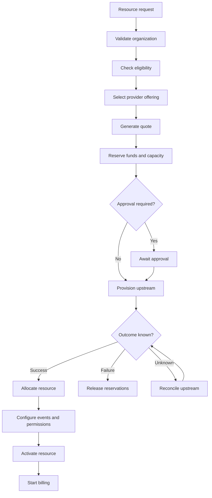

### Naelao — Managed Services, Provider Infrastructure and AgentPort Integration

Technical architecture, commercial model and implementation specification — V1.0

This specification establishes how Naelao builds its own infrastructure providers, integrates third-party providers, manages customer resources, provisions external accounts, handles multi-tenancy and monetizes the ecosystem.

It is designed to serve as an implementation reference for developers and coding agents working on Naelao.

The scope is the entire Naelao Managed and provider infrastructure ecosystem, including its relationship with AgentPort and Naelao OS. It is not a replacement for the existing Naelao OS specification covering workspaces, projects, assistants, agents, workflows, microapps and templates.

### Part I — Product strategy

### 1\. Vision

Naelao should allow individuals, developers, organizations and autonomous agents to acquire and operate digital resources without manually managing dozens of provider accounts, subscriptions, credentials and infrastructure systems.

A user should be able to create a business inside Naelao and provision everything it needs:

* AI models and inference.

* Email addresses and inboxes.

* Phone numbers, SMS and voice.

* WhatsApp and iMessage accounts.

* Browser environments.

* Compute and execution environments.

* File and object storage.

* Search and web crawling.

* External business accounts.

* Payment infrastructure, where permitted.

* Specialized APIs and tools.

Every resource should be accessible through a consistent provisioning, authorization, consumption and billing experience.

Naelao should not need to build every service itself. It should combine first-party providers, commercial partnerships and customer-owned accounts.

The guiding principle is:

Simple for customers. Sophisticated underneath. Independent providers. Unified consumption.

### 2\. Product ecosystem

### Naelao Group

Long-term product ecosystem

### Naelao OS

Application and business operating system

Assistants

Agents and projects

Templates and workflows

Microapps

Marketplace

### Naelao Managed

Unified commercial service layer

Service catalog

Unified credits

Resource provisioning

Usage and subscriptions

Provider selection

### AgentPort

Agent identity and external account infrastructure

Agent identities

Account connections

Credential brokering

Permissions and approvals

Managed external accounts

### Providers by Naelao

Independent first-party infrastructure services

Naelao Email

Naelao Browser

Naelao Compute

Naelao Storage

Future specialized providers

These are product and architectural boundaries. They do not require separate legal entities at launch.

### 3\. Product responsibilities

### 3.1 Naelao OS

Naelao OS is the application layer.

It provides the environment where users create assistants, deploy agents, operate projects, install business templates, build microapps and run organizations.

Naelao OS should consume infrastructure services through stable interfaces rather than implementing provider-specific integrations throughout its codebase.

For example, a project agent should request an email account through AgentPort, not directly through Cloudflare Email or AgentMail.

### 3.2 Naelao Managed

Naelao Managed is the unified commercial and resource consumption layer.

It is responsible for:

* Managed service discovery and purchasing.

* Unified customer billing.

* Service credits and spending limits.

* Provider availability and eligibility.

* Subscription management.

* Resource provisioning orchestration.

* Usage aggregation.

* Customer-facing pricing.

* Provider commercial relationships.

* Cost and profitability monitoring.

Naelao Managed is not itself an email provider, browser provider or compute provider.

It distributes and manages access to those services.

### 3.3 AgentPort

AgentPort is an independent, runtime-agnostic infrastructure product.

It provides the identity, access, credential and external account management layer for AI agents.

It should support Naelao agents, Hermes, OpenClaw, custom applications, coding agents and other external runtimes.

AgentPort is responsible for:

* Internal agent identities.

* Organization-owned external accounts.

* Scoped access grants.

* Secure credential brokering.

* Policy enforcement.

* Human approvals.

* External action execution.

* Event routing and agent wakeups.

* External account lifecycle management.

* Audit and reconciliation.

AgentPort must remain usable without Naelao OS.

### 3.4 AgentPort Managed

AgentPort Managed is the managed external account provisioning capability within AgentPort.

It handles services such as email, telecommunications, messaging and eligible external business accounts.

External AgentPort customers can purchase managed resources directly. Naelao OS customers can purchase the same resources through Naelao Managed.

AgentPort Managed should reuse a common managed commerce infrastructure rather than building a second, incompatible billing and provider management system.

### 3.5 Providers by Naelao

Providers by Naelao are actual first-party infrastructure products.

Naelao Email, for example, is a competitor to AgentMail and Inkbox. It is not merely an AgentPort adapter for Cloudflare.

Each first-party provider should have a distinct service boundary, its own resource model, APIs, metering, operational responsibilities and pricing.

Eventually, these providers can acquire customers independently of Naelao OS and AgentPort.

### Part II — Customer experience

### 4\. The public access model

The customer-facing experience should expose only two access modes.

| Access mode    | Meaning                                                                            |
| -------------- | ---------------------------------------------------------------------------------- |
| Managed        | Naelao provisions, configures, maintains and bills the resource.                   |
| Bring your own | The customer connects an existing provider account and pays the provider directly. |

The distinction between first-party services, master accounts, native subaccounts and other internal provisioning architectures should not appear as separate customer-facing modes.

Provider identity is independent of access mode.

For example, Naelao Email can be purchased directly, provisioned through Managed or connected using an existing Naelao Email account.

### 5\. Provider selection experience

Users should be able to select a specific provider or allow automatic selection.

### Add a resource

Resource typeEmail account

ManagedBring your own

Billed through your Naelao Managed balance.

Interactive UI specification. Prices and managed availability are illustrative, not confirmed commercial offerings.

### 6\. Resource discovery and marketplace

The service catalog should organize offerings by resource category rather than by the internal implementation architecture.

| Category       | Example providers                               |
| -------------- | ----------------------------------------------- |
| Email          | Naelao Email, AgentMail, Inkbox, Gmail, Outlook |
| SMS and voice  | Telnyx, AgentPhone, Twilio                      |
| iMessage       | Linq, Sendblue, AgentPhone                      |
| WhatsApp       | Meta Cloud API, eligible BSPs                   |
| Models         | OpenRouter, model laboratories                  |
| Browsers       | Naelao Browser, Browserbase                     |
| Compute        | Naelao Compute, E2B, Daytona                    |
| Storage        | Naelao Storage, compatible object storage       |
| Search         | Exa, Tavily                                     |
| Crawling       | Firecrawl, future Naelao Crawl                  |
| Payments       | Eligible Stripe and wallet providers            |
| Agent runtimes | Compatible managed execution providers          |

An offering can be BYOK-only, Managed-only or support both modes.

A provider must not be displayed as available for Managed provisioning until its commercial agreement, technical capabilities and pricing have been validated.

### 7\. Resource management dashboard

Every organization should have a centralized resource dashboard.

### Resources

Example organization

Active resources

### 6

Managed

### 5

Monthly fixed fees

### $7.50

sales@example.com

Naelao Email · Managed

$1/mo

support@example.com

AgentMail · Managed

$3/mo

+1 ••• ••• 0124

Telnyx · Managed

$2.50/mo

Research browser

Browserbase · Managed

Usage

Business payments

Stripe · Bring your own

Direct billing

Project storage

Naelao Storage · Managed

$1/mo

The resource detail page should include the provider, resource identifier, assigned agents, permissions, billing mode, current usage, limits, renewal date, activity history, suspension controls and export or transfer options where supported.

### Part III — Internal provider architecture

### 8\. Provider operating models

Internally, Naelao must support multiple operating models. These describe how the platform acquires and operates resources, not how customers interact with them.

### 8.1 Type A: First-party providers

Naelao builds and operates the actual service.

Example: Naelao Email.

Naelao uses Cloudflare Email Service for inbound and outbound email transport while implementing its own mailbox system, storage, search, threading, resource management and multi-tenancy.

Cloudflare infrastructure

Email Service · Workers · D1 · R2 · Queues

### Naelao Email

Independent provider API, mailbox infrastructure and metering

Direct API

Developers

AgentPort

External agents

Naelao OS

Native customers

Naelao Email owns the product implementation. Cloudflare supplies underlying infrastructure.

Responsibilities include tenant isolation, resource allocation, provider APIs, service reliability, usage metering, abuse prevention, billing and support.

The same model can later apply to Naelao Browser, Naelao Compute, Naelao Storage and other first-party providers.

### 8.2 Type B: Managed master account

Naelao acquires an authorized commercial account with a third-party provider and distributes resources under that account.

Example: AgentMail.

AgentMail

Authorized Naelao commercial account

Naelao provider management layer

Tenant mapping · Allocation · Quotas · Metering

Organization A

Allocated inboxes

Organization B

Allocated inboxes

Organization C

Allocated inboxes

Naelao must maintain a mapping between upstream resources and customer organizations.

Customers never receive access to the master account API key.

Every operation must be authorized against the specific resource allocation before execution.

Where a provider cannot support sufficiently safe resource isolation, Naelao must use dedicated accounts or decline to offer that provider in Managed mode.

### 8.3 Type C: Provider-native multi-tenancy

Some providers offer native subaccounts, connected accounts, reseller organizations or project-level isolation.

In this model, Naelao creates a provider-side partition for each eligible customer organization.

The provider may handle much of the underlying isolation, usage reporting and lifecycle management.

Naelao remains responsible for mapping organizations to provider partitions, managing authorization, normalizing capabilities, customer billing and reconciliation.

Provider-native multi-tenancy should be preferred over custom master-account isolation when it offers stronger security and commercially viable pricing.

### 8.4 Type D: Customer-owned provider accounts

The customer connects their own provider account.

Naelao does not purchase or resell the upstream service.

The platform may still provide credential management, scoped execution, governance, events and usage visibility.

Provider billing remains the customer's responsibility.

### 8.5 Type E: Partner-direct provisioning

An additional model should support providers that require the customer to establish a direct contractual relationship.

Naelao initiates or facilitates onboarding, but the provider performs customer verification, owns the commercial relationship and bills the customer directly.

Naelao may receive referral revenue, revenue sharing or a separate platform fee.

This is particularly relevant to regulated financial services, certain telecommunications products and enterprise software.

### 9\. Operating model comparison

| Responsibility   | First-party    | Master account    | Native subaccount | BYOK                | Partner-direct         |
| ---------------- | -------------- | ----------------- | ----------------- | ------------------- | ---------------------- |
| Operates service | Naelao         | Provider          | Provider          | Provider            | Provider               |
| Tenant isolation | Naelao         | Naelao + provider | Provider + Naelao | Customer + provider | Provider               |
| Upstream billing | Naelao         | Naelao            | Configurable      | Customer            | Customer               |
| Customer billing | Naelao         | Naelao            | Configurable      | Provider            | Provider               |
| Provisioning     | Naelao         | Naelao            | Provider API      | Existing account    | Partner onboarding     |
| Platform revenue | Product margin | Resale margin     | Management margin | Platform fees       | Referral/platform fees |

All five operating models should be represented using the same resource abstraction.

### Part IV — System architecture

### 10\. High-level architecture

### Consumer applications

Naelao OS · AgentPort dashboard · External SDKs · MCP · CLI

API Gateway

Authentication · Organization context · Rate limits

Managed Commerce

Catalog, quotes, billing, subscriptions

AgentPort Core

Identity, grants, credentials, approvals

Resource Manager

Allocation, provisioning, lifecycle

Execution Gateway

Authorized provider operations

Metering Engine

Usage, reconciliation, costs

Event Gateway

Webhooks, queues, delivery

Provider Adapter Runtime

Normalized provider interfaces and secure upstream execution

First-party providers

Naelao Email, Browser, Compute

Third-party providers

AgentMail, Telnyx, Linq, others

### 11\. Shared managed commerce infrastructure

Naelao should not build separate billing engines for Naelao OS, AgentPort and every first-party provider.

Instead, establish a reusable internal platform capability, referred to in this specification as Managed Commerce Core.

This is an internal service boundary, not necessarily another public product.

| Module                     | Responsibility                                        |
| -------------------------- | ----------------------------------------------------- |
| Catalog Service            | Providers, offerings, availability and capabilities   |
| Commercial Account Service | Master accounts, contracts and commercial permissions |
| Pricing Service            | Rate cards, quotes, discounts and retail prices       |
| Resource Service           | Resource records and allocations                      |
| Provisioning Service       | Creation, configuration and deletion                  |
| Subscription Service       | Recurring charges and renewals                        |
| Metering Service           | Normalized usage collection                           |
| Ledger Service             | Credits, reservations, charges and refunds            |
| Reconciliation Service     | Upstream costs and billing verification               |
| Risk Service               | Fraud, abuse, eligibility and spending limits         |
| Settlement Service         | Provider invoices and commercial settlement           |
| Entitlement Service        | Product subscriptions and feature limits              |

AgentPort and Naelao OS consume these capabilities through internal APIs.

A customer-facing AgentPort Managed balance and Naelao Managed balance can use the same ledger infrastructure while remaining separately scoped according to product, organization and billing agreement.

### 12\. Control plane and data plane

### Control plane

Responsible for resource configuration, identity, policies, provisioning, subscriptions, pricing, billing and orchestration.

### Data plane

Responsible for actual service operations.

Examples include sending emails, processing inbound messages, making calls, running browsers, executing code and storing files.

### Separation requirements

The control plane must not need to process the full contents of every customer email, browser session or file.

Large data objects should remain within the relevant provider or first-party service.

The central resource record contains identifiers, ownership, capabilities, billing metadata and access configuration.

This prevents Naelao Managed from becoming an unnecessary data bottleneck.

### 13\. Cloudflare-native deployment

Given Naelao's existing infrastructure direction, the proposed initial deployment is Cloudflare-native.

| Infrastructure  | Responsibility                                                   |
| --------------- | ---------------------------------------------------------------- |
| Workers         | APIs, provider adapters and lightweight execution                |
| Durable Objects | Serialized coordination, reservations and resource-level state   |
| D1              | Catalog, organizations, resource metadata and relational records |
| R2              | Attachments, raw messages, exports and large objects             |
| Queues          | Asynchronous events, retries and usage processing                |
| Workflows       | Long-running provisioning and reconciliation                     |
| Cron Triggers   | Renewals, periodic reconciliation and health checks              |
| Containers      | Heavy execution where required                                   |
| Workers secrets | Bootstrap credentials and service-level secrets                  |

The customer credential vault must be a dedicated encrypted storage system with controlled key management. Worker environment secrets alone are not a suitable multi-tenant credential database.

Financial ledger consistency must be explicitly engineered. Do not assume that independent writes across D1, Durable Objects and upstream providers form a single atomic transaction.

For the initial release, a modular deployment is preferable to dozens of independently deployed microservices. Service boundaries should exist in code and interfaces even when modules share a deployment.

### Part V — Domain model and database

### 14\. Core entities

The following entities form the canonical platform model.

| Entity                | Purpose                                     |
| --------------------- | ------------------------------------------- |
| User                  | Human user identity                         |
| Organization          | Tenant and resource ownership boundary      |
| Membership            | Human membership and organization roles     |
| BillingAccount        | Commercial account responsible for charges  |
| Workspace             | Naelao workspace or operational context     |
| Project               | Project-level resource grouping             |
| AgentIdentity         | Internal agent principal                    |
| Provider              | Service operator                            |
| ProviderAdapter       | Technical integration implementation        |
| ProviderOffering      | Purchasable service configuration           |
| CommercialAgreement   | Approved distribution terms                 |
| ProviderConnection    | Authenticated upstream connection           |
| MasterAccount         | Platform-controlled provider account        |
| ProviderPartition     | Upstream subaccount or tenant partition     |
| Resource              | Canonical customer resource                 |
| ResourceAllocation    | Upstream resource mapping                   |
| ExternalAccount       | External identity or communication account  |
| AccessGrant           | Agent permission over a resource            |
| CredentialReference   | Secure reference to encrypted credentials   |
| ProvisioningOperation | Durable provisioning state                  |
| ExecutionOperation    | External action state                       |
| UsageEvent            | Normalized usage measurement                |
| RateCard              | Versioned pricing configuration             |
| Quote                 | Time-limited pricing commitment             |
| Subscription          | Recurring resource or platform charge       |
| LedgerAccount         | Financial accounting account                |
| LedgerEntry           | Immutable accounting entry                  |
| ApprovalRequest       | Human or policy authorization request       |
| AuditEvent            | Security and operational history            |
| ProviderInvoice       | Upstream invoice                            |
| ReconciliationRecord  | Comparison of internal and upstream records |

### 15\. Resource model

A resource must be independent of the provider operating model.

```typescript
type AccessMode = "managed" | "byok";

type ProvisioningStrategy =
  | "first_party"
  | "managed_master"
  | "native_subaccount"
  | "customer_connection"
  | "partner_direct";

type ResourceStatus =
  | "requested"
  | "pending_verification"
  | "provisioning"
  | "active"
  | "degraded"
  | "suspended"
  | "deprovisioning"
  | "deleted"
  | "failed"
  | "unknown";

interface Resource {
  id: string;
  organizationId: string;
  billingAccountId: string;

  projectId?: string;

  category: string;
  resourceType: string;
  displayName: string;

  providerId: string;
  offeringId: string;

  accessMode: AccessMode;
  provisioningStrategy: ProvisioningStrategy;

  providerConnectionId?: string;
  providerPartitionId?: string;
  upstreamResourceId?: string;

  credentialReferenceId?: string;

  status: ResourceStatus;

  rateCardVersionId?: string;
  subscriptionId?: string;

  configuration: Record<string, unknown>;
  metadata: Record<string, unknown>;

  createdAt: string;
  updatedAt: string;
  deletedAt?: string;

  version: number;
}
```

Provider-specific configuration must be validated against the selected offering's schema.

Do not permit arbitrary customer-supplied metadata to override trusted provider identifiers, tenant ownership, billing information or authorization configuration.

### 16\. Ownership model

Resource ownership must distinguish between several concepts.

| Ownership dimension     | Example                       |
| ----------------------- | ----------------------------- |
| Service operator        | AgentMail                     |
| Upstream account holder | Naelao                        |
| Resource controller     | Customer organization         |
| Credential controller   | AgentPort vault               |
| Billing responsibility  | Naelao Managed                |
| Authorized principal    | Customer's sales agent        |
| Transfer rights         | Defined by provider agreement |

An organization controlling an allocated phone number does not necessarily legally own the number or have unrestricted transfer rights.

These distinctions must be stored explicitly and disclosed where relevant.

### 17\. Database invariants

Every tenant-owned record must carry an organization identifier or an immutable reference to its organization.

Important database constraints include:

| Constraint          | Requirement                                                                                                        |
| ------------------- | ------------------------------------------------------------------------------------------------------------------ |
| Resource allocation | One upstream resource cannot belong to unrelated organizations unless explicitly designed as shared infrastructure |
| Idempotency         | Unique operation key within its defined scope                                                                      |
| Provider connection | Must belong to the customer or an approved platform commercial account                                             |
| Access grants       | Must reference a valid principal and resource                                                                      |
| Ledger              | Entries cannot be edited after posting                                                                             |
| Usage events        | Duplicate upstream events must not produce duplicate charges                                                       |
| Pricing             | Historical charges retain the applicable rate-card version                                                         |
| Resource deletion   | Preserve required financial and audit records                                                                      |
| Tenant references   | Cross-organization references require explicit authorized sharing                                                  |

Tenant isolation must be enforced at the service and data-access layers. Random UUIDs are not an authorization mechanism.

### Part VI — Provider registry and adapters

### 18\. Provider registry

Every provider, including first-party Naelao providers, must be registered using the same provider abstraction.

```typescript
interface Provider {
  id: string;
  slug: string;
  displayName: string;

  operatorType: "first_party" | "third_party";

  websiteUrl?: string;
  documentationUrl?: string;

  categories: string[];

  status:
    | "development"
    | "sandbox"
    | "active"
    | "degraded"
    | "disabled";

  adapterVersion: string;

  createdAt: string;
  updatedAt: string;
}
```

Naelao Email is registered as a first-party provider.

AgentMail is registered as a third-party provider.

Cloudflare Email is an upstream dependency of Naelao Email and does not need to appear as the mailbox provider presented to customers.

### 19\. Provider offerings

A provider can publish multiple offerings.

For example, Telnyx could have separate offerings for US SMS-enabled numbers, international numbers, voice-only numbers and other eligible telecommunications products.

```typescript
interface ProviderOffering {
  id: string;
  providerId: string;

  name: string;
  resourceType: string;

  supportedAccessModes: AccessMode[];
  provisioningStrategies: ProvisioningStrategy[];

  supportedRegions: string[];
  capabilities: string[];

  configurationSchema: Record<string, unknown>;

  eligibilityPolicyId: string;
  commercialAgreementId?: string;

  pricingModelId: string;

  status:
    | "draft"
    | "testing"
    | "available"
    | "restricted"
    | "deprecated"
    | "disabled";
}
```

Commercial approval should exist at the offering level, not merely at the provider level.

A provider may permit resale of one service while prohibiting redistribution of another.

### 20\. Provider adapter interface

Every adapter implements the operations relevant to its supported capabilities.

```typescript
interface ProviderAdapter {
  getCapabilities(): Promise<ProviderCapabilities>;

  validateConnection(
    context: ConnectionContext
  ): Promise<ConnectionValidation>;

  checkAvailability(
    request: AvailabilityRequest
  ): Promise<AvailabilityResult>;

  quote(
    request: ProviderQuoteRequest
  ): Promise<ProviderQuote>;

  provision(
    request: ProvisionRequest
  ): Promise<ProvisionResult>;

  getResource(
    request: ResourceLookupRequest
  ): Promise<ProviderResource>;

  updateResource(
    request: ResourceUpdateRequest
  ): Promise<ProviderResource>;

  suspend(
    request: ResourceOperationRequest
  ): Promise<OperationResult>;

  resume(
    request: ResourceOperationRequest
  ): Promise<OperationResult>;

  deprovision(
    request: ResourceOperationRequest
  ): Promise<OperationResult>;

  execute(
    request: AuthorizedExecutionRequest
  ): Promise<ExecutionResult>;

  getUsage(
    request: UsageQuery
  ): Promise<ProviderUsage[]>;

  verifyWebhook(
    request: WebhookRequest
  ): Promise<WebhookVerification>;

  normalizeWebhook(
    request: VerifiedWebhook
  ): Promise<NormalizedEvent[]>;

  reconcile(
    request: ReconciliationRequest
  ): Promise<ReconciliationResult>;
}
```

Unsupported operations must return a standardized capability error.

They must not silently succeed or pretend to perform an unsupported action.

### 21\. Capability registry

Capabilities should be granular.

Examples:

```text
email.inbox.create
email.inbox.delete
email.message.read
email.message.send
email.message.draft
email.attachment.read

phone.number.search
phone.number.provision
phone.number.release
sms.message.send
sms.message.receive

voice.call.create
voice.call.answer
voice.call.end

browser.session.create
browser.session.execute
browser.session.terminate

compute.instance.create
compute.command.execute
compute.instance.stop

storage.object.read
storage.object.write
storage.object.delete
```

Capabilities are used for catalog filtering, resource eligibility, access grants, execution authorization and provider selection.

A resource must never advertise a capability unsupported by its actual provider offering.

### 22\. Commercial agreement registry

Technical API access does not imply commercial redistribution rights.

The commercial agreement registry should contain:

```typescript
interface CommercialAgreement {
  id: string;
  providerId: string;

  agreementType:
    | "standard_terms"
    | "reseller"
    | "wholesale"
    | "platform_partner"
    | "referral"
    | "first_party";

  permittedOfferingIds: string[];

  permitsManagedProvisioning: boolean;
  permitsMasterAccountDistribution: boolean;
  permitsSubaccountDistribution: boolean;
  permitsCommercialRedistribution: boolean;
  permitsSharedResources: boolean;

  permittedRegions: string[];

  minimumCommitmentMinor?: string;
  currency: string;

  effectiveFrom: string;
  expiresAt?: string;

  verificationStatus:
    | "unverified"
    | "under_review"
    | "approved"
    | "expired"
    | "revoked";

  evidenceReference?: string;
}
```

Managed provisioning must fail closed when required commercial authorization is missing or expired.

### Part VII — Multi-tenancy

### 23\. Tenant hierarchy

The proposed hierarchy is:

Resources belong to the organization and may be assigned to projects or agents through scoped grants.

An agent is not a tenant.

A workspace is not necessarily a billing account.

An external account is not necessarily dedicated to one agent.

The organization is the primary resource ownership and isolation boundary.

### 24\. Shared resources within an organization

An organization may own one support email account and grant different permissions to multiple agents.

support@company.com

Organization-owned external account

Triage agent

Read

Drafting agent

Read + draft

Response agent

Approved send

This is an important AgentPort advantage over platforms that automatically create one external account per agent.

Customers should not be forced to pay for unnecessary phone numbers or inboxes simply because they have many internal agents.

### 25\. Shared resources across organizations

Cross-organization sharing requires a separate architecture.

For example, a Naelao-operated personal assistant could use one eligible shared messaging endpoint to serve many individual customers.

The endpoint belongs to Naelao. Each conversation is mapped to an isolated customer identity.

This does not mean every customer owns or has access to the underlying phone number.

The system must distinguish:

| Resource type            | Description                                                 |
| ------------------------ | ----------------------------------------------------------- |
| Dedicated resource       | Exclusively allocated to one organization                   |
| Organization-shared      | Shared among authorized agents in one organization          |
| Platform-shared endpoint | Naelao-operated service endpoint serving multiple customers |
| Shared infrastructure    | Underlying compute, storage or provider capacity            |

Platform-shared messaging must be explicitly permitted by the provider and must enforce strict conversation isolation, identity verification and abuse controls.

### 26\. Master account capacity management

For providers offering capacity-based plans, Naelao needs a capacity pool.

Example:

```typescript
interface CapacityPool {
  id: string;
  providerId: string;
  masterAccountId: string;

  resourceType: string;
  totalCapacity: number;

  reservedCapacity: number;
  allocatedCapacity: number;

  safetyBuffer: number;

  monthlyCommitmentMinor: string;

  status:
    | "available"
    | "near_capacity"
    | "full"
    | "suspended";
}
```

Capacity allocation must be serialized or otherwise transactionally protected.

The system should track unused capacity, utilization, resource acquisition costs and renewal commitments.

Do not provision beyond the provider's permitted capacity.

When a master account approaches its limit, the provisioning service should either allocate another approved pool, request an upgrade or temporarily reject new requests.

### 27\. Blast-radius management

A single master account serving thousands of unrelated organizations creates operational risk.

If the provider suspends that account, every customer may lose service.

Naelao should support multiple master accounts or isolated provider partitions where permitted, segmented by geography, customer risk, resource type or commercial contract.

Segmentation must not be used to evade provider enforcement or account restrictions.

High-risk customers and regulated services may require dedicated infrastructure.

### Part VIII — AgentPort integration

### 28\. Internal agent identities

An AgentPort identity represents an agent principal.

Creating an identity must not automatically create an email address, phone number or wallet.

```typescript
interface AgentIdentity {
  id: string;
  organizationId: string;

  displayName: string;

  runtimeType: string;
  runtimeReference?: string;

  status:
    | "active"
    | "suspended"
    | "revoked";

  createdAt: string;
}
```

An identity can exist without any external accounts.

External accounts are assigned independently through access grants.

### 29\. Access grants

```typescript
interface AccessGrant {
  id: string;
  organizationId: string;

  principalType: "agent" | "user" | "service";
  principalId: string;

  resourceId: string;

  allowedActions: string[];

  conditions: {
    allowedRecipients?: string[];
    allowedDomains?: string[];
    maxActionsPerHour?: number;
    maxSpendMinor?: string;
    approvalPolicyId?: string;
  };

  expiresAt?: string;
  revokedAt?: string;
}
```

Every external operation must validate the principal, organization, resource, capability, grant, conditions and applicable policies.

Credentials must not be handed to agents merely because they have an access grant.

### 30\. Secure execution pipeline

AgentPort should retain its established execution model:

Propose → Evaluate → Approve → Execute → Reconcile

1

Propose

Agent submits an intended action.

2

Evaluate

Validate identity, resource, permission, policy, budget and risk.

3

Approve

Obtain required human or deterministic policy authorization.

4

Execute

Broker credentials and invoke the approved provider operation.

5

Reconcile

Record actual outcome, usage, charges and audit evidence.

Approvals must be bound to the immutable action payload, resource, principal, expiration time and authenticated approver.

Changing the recipient, message contents, amount or resource after approval invalidates the approval.

An LLM reviewer may provide a risk assessment, but must not replace deterministic security enforcement.

### 31\. Credential brokering

The credential vault should support encrypted storage, credential rotation, provider-specific OAuth flows, revocation and controlled execution.

Credentials should be decrypted only within the authorized execution boundary.

Master account credentials require stronger access restrictions than ordinary customer credentials.

Secrets must never appear in logs, usage events, audit payloads, frontend responses or agent-visible tool results.

### Part IX — Provisioning engine

### 32\. Provisioning workflow

A provisioning operation must be durable, recoverable and idempotent.

The normal lifecycle is:



### 33\. Provisioning request

```json
{
  "resource_type": "email.inbox",
  "access_mode": "managed",
  "provider": "auto",
  "configuration": {
    "display_name": "Sales inbox"
  },
  "project_id": "project_123",
  "budget": {
    "currency": "USD",
    "maximum_monthly_minor": "500"
  },
  "idempotency_key": "provision_sales_inbox_001"
}
```

The organization must be derived from the authenticated request context rather than trusted from arbitrary request parameters.

### 34\. Provisioning failure handling

| Failure                                 | Required behavior                             |
| --------------------------------------- | --------------------------------------------- |
| Insufficient balance                    | Reject before upstream provisioning           |
| Provider unavailable                    | Retry safely or offer an eligible alternative |
| Verification required                   | Enter pending-verification state              |
| Provider timeout                        | Mark outcome unknown and reconcile            |
| Duplicate request                       | Return original operation result              |
| Partial provisioning                    | Resume workflow or perform approved cleanup   |
| Price changed                           | Obtain a new quote and authorization          |
| Capacity exhausted                      | Allocate another approved pool or reject      |
| Upstream created but local write failed | Recover through reconciliation                |

A timeout does not prove that provisioning failed.

Never blindly retry a non-idempotent upstream creation request after an ambiguous timeout.

### 35\. Resource lifecycle

Resources should support the following transitions.

Simplified normal lifecycle. Failure, verification and unknown-outcome states are handled separately.

Deletion should be treated carefully for phone numbers, email addresses and other persistent identities.

Customers should receive appropriate renewal and deletion notices. Where possible, suspended resources should retain a grace period before irreversible release.

### Part X — Provider selection and routing

### 36\. Automatic provider selection

When a user chooses Automatic, the platform should first filter providers by hard eligibility requirements.

These include:

* Required capabilities.

* Geographic availability.

* Customer eligibility.

* Commercial distribution approval.

* Data residency requirements.

* Budget.

* Provider health.

* Available capacity.

* Security and isolation requirements.

Only eligible offerings enter the ranking stage.

A proposed scoring model is:

S = 0.30C + 0.25R + 0.20F + 0.15A + 0.10P

Where:

| Factor | Meaning                   |
| ------ | ------------------------- |
| C      | Customer cost score       |
| R      | Reliability score         |
| F      | Capability fit            |
| A      | Availability and capacity |
| P      | Customer preference       |

The weights are configurable policy defaults, not validated optimal values.

First-party providers may receive a preference when they provide equivalent or better customer outcomes. They must not bypass hard eligibility requirements.

### 37\. Routing vs provisioning

There is an important difference between routing interchangeable requests and provisioning persistent resources.

An LLM inference request may be routed between compatible providers.

An email address or phone number is persistent. Switching providers may change the address, number, history or ownership.

Therefore, AgentPort must not silently migrate persistent resources just because another provider becomes cheaper.

Migration requires capability checks, customer authorization and a defined transfer or replacement workflow.

### Part XI — Pricing and monetization

### 38\. Revenue architecture

Naelao should earn money from multiple independent revenue streams.

| Revenue stream                         | Product             |
| -------------------------------------- | ------------------- |
| OS subscriptions                       | Naelao OS           |
| Template subscriptions and commissions | Naelao OS           |
| Hosted identity and execution          | AgentPort Cloud     |
| Managed account provisioning           | AgentPort Managed   |
| Managed resource consumption           | Naelao Managed      |
| First-party infrastructure usage       | Providers by Naelao |
| Enterprise support and governance      | Relevant product    |
| Authorized partner commissions         | Managed commerce    |

No single revenue stream should be required to subsidize every other product.

### 39\. AgentPort OSS and Cloud

My proposed commercial structure is open-core.

AgentPort OSS includes the core self-hostable identity, permissions, credential brokering, adapters, SDK, CLI and execution functionality.

AgentPort Cloud monetizes hosted operations, durable events, higher limits, team management, enterprise governance and operational reliability.

### Illustrative launch plans

| Feature              | Free    | Pro     | Business  |
| -------------------- | ------- | ------- | --------- |
| Monthly subscription | $0      | $29     | $149      |
| Agent identities     | 5       | 50      | 500       |
| External accounts    | 5       | 50      | 500       |
| Included actions     | 10,000  | 100,000 | 1 million |
| BYOK                 | Yes     | Yes     | Yes       |
| Managed purchasing   | Yes     | Yes     | Yes       |
| Core permissions     | Yes     | Yes     | Yes       |
| Advanced governance  | Limited | Limited | Yes       |
| Enterprise SLA       | No      | No      | Optional  |

These are pricing hypotheses. Actual limits should be established from measured execution costs and customer demand.

Security-critical capabilities such as basic authorization and credential protection must not be withheld from free users.

### 40\. Managed pricing components

Each offering can have multiple charge dimensions.

| Component          | Example                                  |
| ------------------ | ---------------------------------------- |
| Setup fee          | Custom domain configuration              |
| Resource rental    | Monthly phone number                     |
| Included allowance | 1,000 emails                             |
| Consumption fee    | Additional messages                      |
| Storage fee        | GB-month                                 |
| Execution fee      | Compute seconds                          |
| Premium support    | Dedicated account management             |
| Regulatory fee     | Eligible telecommunications registration |

The catalog must display applicable charges before purchase.

Do not advertise a resource as $1/month if mandatory fees make its actual minimum cost materially higher.

### 41\. Internal rate cards

Naelao needs four independent pricing layers.

| Rate card       | Purpose                                        |
| --------------- | ---------------------------------------------- |
| Upstream cost   | Actual provider or infrastructure cost         |
| Provider retail | Direct first-party provider customers          |
| Wholesale       | Authorized distributors and internal products  |
| Managed retail  | AgentPort Managed and Naelao Managed customers |

Example for Naelao Email:

Illustrative monthly economics per inbox

Operating cost

$0.15

Wholesale price

$0.60

Direct retail price

$1.00

Managed retail price

$1.00

Provider contribution

### $0.45

Distribution contribution

### $0.40

Hypothetical unit economics before additional distribution costs. Consolidated contribution is $0.85, not the sum of internal and external revenue.

Internal wholesale rates allow Naelao to evaluate each product's performance without double-counting revenue.

### 42\. Managed retail pricing strategies

The pricing engine should support fixed fees, percentage markups, cost passthrough, tiered rates, bundled allowances, volume discounts, minimum commitments and negotiated enterprise rates.

A target-margin formula is:

P = \\frac{C}{1-M}

Where is the retail price, is the total direct cost and is the target gross margin.

For example, a resource costing $1.25 with a target margin of 50% requires a retail price of $2.50.

### Interactive pricing calculator

Upstream cost ($)

Infrastructure cost ($)

Support allocation ($)

Risk allowance ($)

Target gross margin

35%

Monthly resources sold

1,000

Direct unit cost

### $1.30

Required retail price

### $2.00

Monthly revenue

### $2,000.00

Monthly gross profit

### $700.00

### 43\. Capacity-based provider economics

When Naelao purchases a provider subscription containing a fixed number of resources, utilization becomes critical.

Suppose an authorized upstream plan costs $100/month and contains 100 inboxes.

Naelao sells each inbox for $2/month.

Break-even occurs at 50% utilization before infrastructure, payment processing, support and other direct costs.

The capacity manager should calculate expected utilization and effective cost per sold resource.

Initially, Naelao should avoid large prepaid capacity commitments unless sufficient customer demand already exists.

### 44\. Proposed pricing targets

| Offering                  | Illustrative retail target                  |
| ------------------------- | ------------------------------------------- |
| Naelao Email              | From $1/inbox/month                         |
| Managed third-party email | From $2–$5/inbox/month                      |
| US managed phone number   | From $2.50/month                            |
| SMS                       | Usage-based                                 |
| Voice                     | Usage-based                                 |
| Dedicated iMessage        | Provider-specific pricing                   |
| WhatsApp                  | Applicable messaging and management charges |
| Browser                   | Session or time-based                       |
| Compute                   | CPU, memory and execution time              |
| Storage                   | Capacity and operations                     |
| LLM inference             | Token or request-based                      |

These prices are not launch commitments. In particular, AgentMail, Linq and other managed third-party prices depend on confirmed commercial arrangements.

### 45\. Avoiding provider bypass

Naelao should not rely on hiding providers or restricting BYOK.

The platform should offer genuine economic and operational advantages: smaller purchasable units, consolidated billing, automatic configuration, cross-provider permissions, unified event delivery, provider portability where possible and volume discounts.

For example, if an upstream provider requires a $100 subscription, a customer needing only two inboxes may prefer purchasing two managed inboxes for $4.

First-party providers strengthen this advantage by allowing Naelao to control more of its cost structure.

### Part XII — Billing, credits and metering

### 46\. Unified billing experience

Customers should have one billing dashboard for their Naelao consumption.

Example Naelao billing account

### $71.50

Available managed service credits

Reserved funds

### $5.00

Usage this month

### $28.50

Monthly usage breakdown

Models

$8.00

Email

$2.00

Phone and SMS

$8.50

Browser

$3.00

Compute

$5.00

Search

$2.00

Example assumes $105 in starting credits, $28.50 consumed and $5 reserved.

Naelao Managed service credits are intended for purchasing platform services. They should not automatically become a transferable financial wallet or a customer-to-customer payment system.

### 47\. Ledger architecture

The ledger must be append-only and support double-entry accounting.

Financial amounts must not use floating-point arithmetic.

Use integer minor units for normal currency amounts and an explicitly defined higher-precision fixed-point unit for fractional usage charges.

Ledger transaction types include top-ups, reservations, releases, usage charges, subscription charges, refunds, promotional credits, adjustments and chargebacks.

Every posted transaction must balance.

A simplified service-credit transaction example:

| Event                | Available credits | Reserved | Consumed |
| -------------------- | ----------------- | -------- | -------- |
| Top-up               | $50.00            | $0.00    | $0.00    |
| Reserve operation    | $45.00            | $5.00    | $0.00    |
| Actual usage $3      | $47.00            | $0.00    | $3.00    |
| Subscription renewal | $44.50            | $0.00    | $5.50    |

The actual accounting implementation must distinguish customer credit liabilities, earned revenue, provider payables and promotional credits.

A top-up is not automatically earned revenue.

### 48\. Usage events

```typescript
interface UsageEvent {
  id: string;

  organizationId: string;
  billingAccountId: string;
  resourceId: string;

  providerId: string;
  offeringId: string;

  operationId?: string;
  upstreamEventId?: string;

  meter: string;
  quantity: string;
  unit: string;

  occurredAt: string;
  receivedAt: string;

  rateCardVersionId: string;

  status:
    | "pending"
    | "rated"
    | "charged"
    | "reconciled"
    | "disputed";

  idempotencyKey: string;
}
```

Examples of meters:

| Service | Meter                     |
| ------- | ------------------------- |
| Email   | Messages sent             |
| Email   | Storage byte-seconds      |
| SMS     | Billable message segments |
| Voice   | Billable call duration    |
| Browser | Session duration          |
| Compute | CPU and memory usage      |
| LLM     | Input and output tokens   |
| Storage | Operations and capacity   |

Each provider adapter normalizes its upstream billing units into canonical meters.

### 49\. Usage charging workflow

The charging system must validate usage, deduplicate events, select the applicable rate-card version, calculate charges, settle reservations and post immutable ledger entries.

Late provider usage events must be supported.

Usage estimates displayed in real time should be clearly distinguished from reconciled charges.

When actual upstream usage differs from estimated usage, the reconciliation system should create an auditable adjustment rather than silently rewriting history.

### 50\. Spending limits

Limits should be hierarchical.

Organization budget — $500/month

Sales project — $150/month

Sales agent — $50/month

Research agent — $30/month

Support project — $100/month

The effective allowed expenditure is constrained by every applicable parent and resource limit.

Concurrent operations must not be able to overspend a budget through race conditions.

Long-running operations such as calls or compute sessions should support incremental reservations and termination limits where the provider allows them.

### 51\. Subscriptions and renewals

Every recurring resource should have a subscription record.

It must include the billing interval, renewal date, rate-card version, grace period, cancellation policy and upstream commitment.

Renewal workflows should attempt payment or credit deduction before the provider commitment renews where practical.

If renewal fails, apply the offering's documented suspension and recovery policy.

Irreversible deletion must not occur immediately after a transient payment failure.

### 52\. Provider reconciliation

Naelao must compare internal usage and resource inventory against upstream records.

The reconciliation engine should detect:

| Discrepancy                | Example                                               |
| -------------------------- | ----------------------------------------------------- |
| Orphaned upstream resource | Phone number exists without local allocation          |
| Missing upstream resource  | Local inbox is active but provider deleted it         |
| Unbilled usage             | Provider reports messages absent from internal ledger |
| Duplicate charges          | Same event rated multiple times                       |
| Unexpected price change    | Provider raises unit price                            |
| Unused commitment          | Paid capacity remains unallocated                     |
| Subscription mismatch      | Customer cancelled but upstream resource still renews |

Unresolved discrepancies should enter an operational review queue.

### Part XIII — First-party providers

### 53\. Providers by Naelao architecture

Every first-party provider should implement the same basic commercial and technical requirements.

| Component               | Requirement                         |
| ----------------------- | ----------------------------------- |
| Native API              | Usable independently                |
| Tenant management       | Strong isolation                    |
| Resource provisioning   | Programmatic lifecycle              |
| Authentication          | Scoped API credentials              |
| Usage metering          | Provider-native meters              |
| Billing integration     | Shared commerce infrastructure      |
| Documentation           | Independent developer documentation |
| Observability           | Service-specific health and metrics |
| AgentPort adapter       | Where relevant                      |
| Naelao Managed offering | Native purchasing integration       |

First-party providers must not depend on Naelao OS for basic operation.

### 54\. Naelao Email — first provider

Naelao Email should be the initial implementation of this architecture.

Its goal is to provide API-native email accounts for applications and AI agents, competing with services such as AgentMail and Inkbox.

### Proposed capabilities

| Capability               | Initial release       |
| ------------------------ | --------------------- |
| Inbox provisioning       | Yes                   |
| Managed domains          | Yes                   |
| Custom domains           | Subject to validation |
| Inbound email            | Yes                   |
| Outbound email           | Yes                   |
| Message threading        | Yes                   |
| Attachment storage       | Yes                   |
| Webhooks                 | Yes                   |
| Search                   | Basic                 |
| Drafts                   | Yes                   |
| Scoped API keys          | Yes                   |
| Delivery status          | Where available       |
| IMAP/SMTP mailbox access | Later                 |
| Human email client       | Optional later        |

### Architecture

Inbound email

Cloudflare Email Routing

Outbound email

Cloudflare Email Sending

### Naelao Email Engine

Routing · MIME parsing · Threading · Authorization · Abuse controls

D1

Metadata

R2

Messages and files

Queues

Async events

Naelao Email API

Direct developers · AgentPort · Naelao Managed

### Email-specific data entities

| Entity           | Purpose                                    |
| ---------------- | ------------------------------------------ |
| EmailTenant      | Provider-level customer                    |
| Domain           | Managed or verified custom domain          |
| Inbox            | Individual mailbox                         |
| EmailAddress     | Address and aliases                        |
| Thread           | Conversation grouping                      |
| Message          | Email metadata and content reference       |
| Attachment       | Stored attachment metadata                 |
| Draft            | Unsent email                               |
| DeliveryAttempt  | Outbound delivery state                    |
| EmailWebhook     | Customer event subscription                |
| SuppressionEntry | Bounces, complaints and blocked recipients |

### Inbound processing

The email handler resolves the recipient to an inbox, validates its active status, stores the raw MIME content, extracts normalized metadata, processes attachments safely, determines the conversation thread and emits a durable inbound message event.

Duplicate deliveries must be deduplicated.

Inbound email content must be treated as untrusted data, including instructions directed at agents.

### Outbound processing

An outbound request must authenticate the caller, validate inbox access, enforce sender and recipient policies, apply sending limits, reserve any applicable usage charge, submit the message to the upstream transport and record the delivery outcome.

Outbound sending must include appropriate abuse controls, suppression handling and domain reputation monitoring.

### Native API surface

```text
POST   /v1/inboxes
GET    /v1/inboxes
GET    /v1/inboxes/:id
DELETE /v1/inboxes/:id

GET    /v1/inboxes/:id/messages
GET    /v1/messages/:id
POST   /v1/inboxes/:id/messages/send

POST   /v1/inboxes/:id/drafts
PATCH  /v1/drafts/:id
POST   /v1/drafts/:id/send

GET    /v1/inboxes/:id/threads
GET    /v1/threads/:id

POST   /v1/domains
POST   /v1/domains/:id/verify

POST   /v1/webhooks
DELETE /v1/webhooks/:id

GET    /v1/usage
```

Naelao Email's API is independent of AgentPort's identity API.

AgentPort implements a Naelao Email adapter in the same manner as its AgentMail adapter.

### 55\. Future first-party providers

The architecture should accommodate future services without requiring their immediate development.

| Provider       | Product opportunity                | Potential competitors         |
| -------------- | ---------------------------------- | ----------------------------- |
| Naelao Email   | Agent-native email                 | AgentMail, Inkbox             |
| Naelao Browser | Managed browser sessions           | Browserbase                   |
| Naelao Compute | Agent execution environments       | E2B, Daytona                  |
| Naelao Storage | Agent-oriented file infrastructure | Managed storage platforms     |
| Naelao Crawl   | Web extraction and crawling        | Firecrawl                     |
| Naelao Search  | Search infrastructure              | Tavily, Exa                   |
| Naelao Voice   | Voice infrastructure               | Voice orchestration providers |

The priority should remain Naelao Email. Other first-party providers should be developed only when existing customer demand, upstream costs or product requirements justify the investment.

### Part XIV — Third-party managed providers

### 56\. Provider onboarding process

Every third-party provider must pass technical and commercial onboarding before Managed activation.

| Stage                  | Deliverable                              |
| ---------------------- | ---------------------------------------- |
| Discovery              | Supported resources and API capabilities |
| Commercial review      | Distribution and resale permissions      |
| Security review        | Credentials, isolation and data access   |
| Pricing review         | Upstream rates and commitments           |
| Adapter implementation | Standardized operations                  |
| Sandbox testing        | Provisioning and execution tests         |
| Billing testing        | Metering and reconciliation              |
| Operational testing    | Failures, suspension and recovery        |
| Limited release        | Controlled customer cohort               |
| Production activation  | Approved public offering                 |

### 57\. Initial provider integration matrix

| Provider       | Category               | Proposed initial mode                    |
| -------------- | ---------------------- | ---------------------------------------- |
| Naelao Email   | Email                  | Managed + direct/BYOK                    |
| AgentMail      | Email                  | BYOK; Managed after approval             |
| Inkbox         | Email                  | BYOK; Managed after approval             |
| Gmail          | Email                  | Customer connection                      |
| Outlook        | Email                  | Customer connection                      |
| Telnyx         | SMS and voice          | BYOK; approved Managed model             |
| AgentPhone     | SMS and voice          | BYOK; approved Managed model             |
| Twilio         | SMS and voice          | BYOK; approved Managed model             |
| Linq           | iMessage and messaging | BYOK; approved Managed model             |
| Sendblue       | iMessage               | BYOK; approved Managed model             |
| Meta Cloud API | WhatsApp               | Eligible customer/platform onboarding    |
| Stripe         | Payments               | Approved connected-account or BYOK model |
| Browserbase    | Browser                | BYOK; Managed after approval             |
| OpenRouter     | Models                 | BYOK; authorized managed consumption     |

This table is an integration roadmap, not a statement that every provider supports the proposed commercial model.

### 58\. Provider health monitoring

The platform should monitor provider API availability, provisioning success, operation latency, rate-limit consumption, webhook failures, billing discrepancies and account suspension status.

Provider health must influence new provisioning decisions.

Existing persistent resources should not be automatically reassigned solely because a provider becomes degraded.

### 59\. Provider suspension

If a provider account is suspended, Naelao should identify affected allocations, stop unsafe operations, prevent new provisioning, notify affected customers and initiate recovery.

The system should distinguish a provider-wide incident from a specific customer suspension.

Provider enforcement must not be bypassed by automatically moving prohibited activity to another account.

### Part XV — APIs, SDKs and developer experience

### 60\. Public managed resource API

```text
GET    /v1/providers
GET    /v1/providers/:id
GET    /v1/offerings
GET    /v1/offerings/:id

POST   /v1/quotes

POST   /v1/resources
GET    /v1/resources
GET    /v1/resources/:id
PATCH  /v1/resources/:id

POST   /v1/resources/:id/suspend
POST   /v1/resources/:id/resume
DELETE /v1/resources/:id

GET    /v1/operations/:id

GET    /v1/billing/balance
GET    /v1/billing/usage
GET    /v1/billing/transactions
GET    /v1/billing/subscriptions
```

### 61\. AgentPort API

```text
POST   /v1/identities
GET    /v1/identities
GET    /v1/identities/:id

POST   /v1/connections
GET    /v1/connections
DELETE /v1/connections/:id

GET    /v1/accounts
GET    /v1/accounts/:id

POST   /v1/grants
GET    /v1/grants
DELETE /v1/grants/:id

POST   /v1/actions/propose
POST   /v1/actions/:id/evaluate
POST   /v1/actions/:id/approve
POST   /v1/actions/:id/execute

GET    /v1/actions/:id
GET    /v1/audit
```

Evaluation and execution endpoints should be restricted to the appropriate authenticated service or principal. A caller cannot approve its own high-impact action merely by invoking the approval endpoint.

### 62\. SDK experience

A developer should be able to provision an account without knowing which operating model is used internally.

```typescript
const account = await agentport.accounts.create({
  type: "email.inbox",
  mode: "managed",
  provider: "auto",
  configuration: {
    displayName: "Support inbox"
  }
});

const agent = await agentport.identities.create({
  displayName: "Support agent"
});

await agentport.grants.create({
  identityId: agent.id,
  accountId: account.id,
  actions: [
    "email.message.read",
    "email.message.draft"
  ]
});
```

Sending a message is a separately authorized operation.

```typescript
const action = await agentport.actions.propose({
  identityId: agent.id,
  accountId: account.id,
  action: "email.message.send",
  payload: {
    to: ["customer@example.com"],
    subject: "Support update",
    text: "Your request has been received."
  }
});
```

The action proceeds only through the applicable authorization and approval workflow.

### 63\. MCP integration

AgentPort should expose a controlled MCP interface for external agents.

Example tool surface:

| Tool                 | Purpose                          |
| -------------------- | -------------------------------- |
| list_accounts        | Discover accessible accounts     |
| get_account          | Read permitted account details   |
| list_offerings       | Discover eligible resources      |
| request_account      | Propose provisioning             |
| read_messages        | Read authorized messages         |
| create_draft         | Draft communication              |
| propose_send_message | Request outbound action          |
| get_action_status    | Track execution                  |
| get_usage            | View permitted usage             |
| request_budget       | Request additional authorization |

Tools must be generated or filtered according to the agent's capabilities and grants.

MCP tool descriptions are not security controls. All permissions must be enforced server-side.

### 64\. API conventions

Every API should support versioning, structured errors, request identifiers, cursor pagination and consistent authentication.

Mutating operations must accept idempotency keys where relevant.

Long-running operations should return an operation identifier and status rather than holding a request open indefinitely.

Standard error codes should include:

```text
AUTHENTICATION_REQUIRED
PERMISSION_DENIED
RESOURCE_NOT_FOUND
CAPABILITY_UNSUPPORTED
PROVIDER_UNAVAILABLE
PROVIDER_NOT_APPROVED
INSUFFICIENT_BALANCE
BUDGET_EXCEEDED
APPROVAL_REQUIRED
VERIFICATION_REQUIRED
CAPACITY_EXHAUSTED
QUOTE_EXPIRED
RATE_LIMIT_EXCEEDED
OPERATION_PENDING
OPERATION_OUTCOME_UNKNOWN
```

Error responses must not expose credentials or unrelated tenant information.

### Part XVI — Events and proactive agents

### 65\. Event gateway

The event gateway receives provider webhooks, verifies authenticity, normalizes payloads, resolves resource ownership and dispatches events.

Naelao Email

AgentMail

Telnyx

Event Gateway

Verification · Deduplication · Tenant resolution

Durable event queue

Retry · Ordering where required · Dead-letter handling

Naelao agents

Projects and assistants

External runtimes

Hermes, OpenClaw, custom

### 66\. Canonical event format

```json
{
  "id": "evt_123",
  "type": "email.message.received",
  "version": 1,
  "organization_id": "org_123",
  "resource_id": "res_123",
  "provider_id": "naelao_email",
  "occurred_at": "2026-11-26T00:00:00Z",
  "data": {
    "message_id": "msg_123",
    "thread_id": "thread_123"
  }
}
```

Sensitive message contents should not be unnecessarily copied into event envelopes.

Authorized consumers can retrieve the contents using the relevant account permissions.

### 67\. Event subscriptions

An agent can subscribe to eligible events from an account.

Examples include inbound messages, missed calls, delivery failures, resource expiration, budget warnings and provisioning completion.

Events must not wake agents that lack current authorization.

Permission revocation should invalidate future event delivery and queued execution where practical.

Delivery should be designed for at-least-once semantics with idempotent consumers. Exactly-once external delivery must not be promised without an actual supporting mechanism.

### Part XVII — Naelao OS integration

### 68\. Workspace and project integration

Naelao OS should expose resources at the organization level and allow them to be assigned to spaces, projects, assistants, agents and workflows.

For example, a real estate workspace may contain a sales project, research project and customer support project.

Each project can use the same organization-owned resources with different access grants.

### 69\. Template resource manifests

Naelao templates should declare required and optional resources.

```yaml
template:
  id: real-estate-agency
  version: 1.0.0

resources:
  - key: sales_email
    type: email.inbox
    required: true
    access_mode: managed
    provider: auto

  - key: business_phone
    type: phone.number
    required: false
    access_mode: managed
    capabilities:
      - sms.message.send
      - sms.message.receive

  - key: research_browser
    type: browser.session
    required: true
    provider: auto

agents:
  - key: sales_agent
    grants:
      - resource: sales_email
        actions:
          - email.message.read
          - email.message.draft

  - key: research_agent
    grants:
      - resource: research_browser
        actions:
          - browser.session.execute
```

The manifest declares requirements. It does not authorize spending or external actions by itself.

### 70\. Template installation workflow

During installation, Naelao should resolve the resource manifest, check existing compatible resources, present managed and BYOK options, calculate estimated costs, obtain authorization, provision missing resources, assign access grants and activate the template.

Where an organization already owns a suitable email inbox or phone number, the installer should offer reuse rather than unnecessarily creating another account.

### Example installation screen

### Install real estate agency template

Required resources and estimated charges

Sales inbox

Naelao Email

$1/mo

Business phone

Telnyx

$2.50/mo

Research browser

Automatic

~$5/mo

AI inference

Automatic

~$10/mo

Estimated managed usage

$18.50/mo

Actual usage varies. Template and OS subscription fees are separate.

### 71\. Microapp integration

Microapps should consume authorized resources through the relevant service interfaces.

An internal customer-support microapp may access an AgentPort email account.

An external storefront may use eligible payment integrations.

A research microapp may use managed browser and search services.

Microapps must not receive unrestricted organization-level credentials merely because they are installed within the same workspace.

### 72\. Template marketplace economics

Template developers and FDEs can generate demand for managed services.

A template builder can earn template revenue while Naelao earns OS subscription and managed infrastructure revenue.

An FDE may receive the agreed subscription commission, installation fee and separately contracted maintenance payments.

Managed infrastructure commissions should be calculated from a defined eligible margin or revenue base, not automatically from the entire amount of provider passthrough charges.

Otherwise, Naelao could pay commissions on money that it owes to upstream providers.

### Part XVIII — Security and compliance

### 73\. Security principles

The entire ecosystem should follow least privilege, explicit authorization, tenant isolation, secure credential handling, auditable execution and fail-closed security decisions.

The following must be treated as separate trust boundaries:

| Boundary                     | Risk                               |
| ---------------------------- | ---------------------------------- |
| Human to platform            | Account takeover                   |
| Agent to platform            | Excessive or compromised authority |
| Platform to provider         | Credential leakage                 |
| Organization to organization | Cross-tenant access                |
| Provider to event gateway    | Forged webhooks                    |
| Billing to execution         | Unauthorized spending              |
| External content to agent    | Prompt injection                   |

### 74\. Prompt injection resistance

Email messages, websites, SMS messages, files and provider responses are untrusted content.

An inbound email telling an agent to disclose credentials, transfer funds or change account permissions must not grant authority.

AgentPort's deterministic permission and approval layer must remain effective even if the agent is manipulated.

External content cannot authorize its own execution.

### 75\. Administrative access

Platform administrators should have narrowly scoped operational permissions.

Access to customer resources should require a documented operational reason and appropriate authorization.

Sensitive support access should be time-limited and audited.

Master account credential access should be restricted to the smallest possible set of execution services and authorized operators.

### 76\. Abuse prevention

Managed infrastructure can attract spam, fraud, unauthorized automation and resource abuse.

Naelao should implement signup risk controls, verification requirements, sending limits, recipient policies, domain reputation monitoring, abuse reporting and rapid suspension.

Free managed service trials should be particularly constrained because upstream resources can incur real costs.

### 77\. Regulated resources

Telecommunications, payment accounts, wallets and some messaging services may require customer verification, licensing, registration or provider-specific onboarding.

Naelao must not represent its own master account verification as a substitute for legally required end-customer verification.

For financial accounts, the preferred architecture is an authorized connected-account or customer-owned model rather than unrestricted pooled custody.

### 78\. Data privacy and retention

Each provider offering should declare its data handling characteristics.

Customers should know the actual service operator, relevant subprocessors, applicable regions and retention policies.

Data deletion workflows must respect legal retention obligations while removing customer data that no longer needs to be retained.

Audit records should minimize sensitive payload contents.

### Part XIX — Operational infrastructure

### 79\. Administrative console

Naelao needs an internal operations dashboard.

### Managed operations

Illustrative administrative dashboard

Active resources

### 2,480

Provisioning success

### 99.2%

Monthly managed billing

### $18,420

Direct provider costs

### $11,850

Provider capacity

Naelao Email

72%

AgentMail

84%

Telnyx

46%

Linq

91%

Linq capacity approaching configured threshold.

All displayed metrics are mock data, not current Naelao operations.

The administrative console should manage provider offerings, commercial approvals, capacity pools, resource inventory, failed operations, customer suspensions, pricing changes, billing discrepancies and service health.

### 80\. Observability

Every operation should carry a correlation identifier across the API gateway, provisioning workflow, provider adapter, event system and ledger.

Operational metrics should include:

| Metric                        | Purpose                        |
| ----------------------------- | ------------------------------ |
| Provisioning success rate     | Resource reliability           |
| Provisioning latency          | Customer experience            |
| Provider execution error rate | Upstream health                |
| Event delivery lag            | Proactive agent reliability    |
| Reconciliation backlog        | Billing and inventory accuracy |
| Gross margin per offering     | Commercial performance         |
| Capacity utilization          | Master-account economics       |
| Cost per active organization  | Platform efficiency            |
| Abuse rate                    | Provider account protection    |

Logs must exclude raw credentials and unnecessary sensitive customer content.

### 81\. Backup and recovery

The platform must define backup policies, restore procedures, recovery time objectives and recovery point objectives.

Financial records, resource mappings and authorization data are especially critical.

Backups must be encrypted and access-controlled.

Recovery testing should be performed before claiming production-grade disaster recovery.

### Part XX — Business structure and financial strategy

### 82\. Independent product economics

Naelao should track the performance of each product independently, even if all products initially operate under one legal entity.

| Product           | Main revenue                         | Main direct costs                  |
| ----------------- | ------------------------------------ | ---------------------------------- |
| Naelao OS         | Subscriptions and templates          | Application infrastructure         |
| AgentPort Cloud   | Platform subscriptions and execution | Identity, events and execution     |
| AgentPort Managed | External account services            | Upstream provider costs            |
| Naelao Managed    | Managed consumption                  | Models, compute and other services |
| Naelao Email      | Email service fees                   | Transport, storage and operations  |

Internal transfer pricing should allow the business to understand whether first-party services are cheaper than third-party alternatives.

However, consolidated financial reporting must eliminate internal revenue.

### 83\. Illustrative consolidated economics

### Naelao ecosystem financial simulator

Paying Naelao OS customers

1,000

Average OS subscription

$20

Managed services adoption

60%

Managed spend per adopting user

$30/mo

Managed gross margin

30%

Independent AgentPort customers

500

Average AgentPort subscription

$29

Naelao OS subscriptions

Managed services billing

AgentPort subscriptions

Monthly customer billing

Managed direct costs

Managed gross profit

Annualized customer billing

Scenario model, not a forecast. Excludes OS and AgentPort hosting costs, salaries, support, taxes, template commissions and other expenses. Gross customer billing may differ from recognized revenue under principal-versus-agent accounting rules.

### 84\. Strategic flywheel

Successful templates attract more customers. Customers generate managed infrastructure demand. Increased demand can improve wholesale purchasing power and justify first-party infrastructure development. Lower costs allow better pricing and margins, attracting more developers and template builders.

This is a potential flywheel, not an automatic outcome. It depends on genuine customer adoption and disciplined unit economics.

### Part XXI — Engineering implementation plan

### 85\. Suggested monorepo structure

The following is a proposed logical structure. Existing Naelao repository conventions should take precedence where they already provide equivalent boundaries.

```text
naelao/
├── apps/
│   ├── naelao-os/
│   ├── agentport-dashboard/
│   ├── managed-admin/
│   └── provider-developer-portal/
│
├── services/
│   ├── api-gateway/
│   ├── agentport-core/
│   ├── managed-commerce/
│   ├── resource-manager/
│   ├── execution-gateway/
│   ├── event-gateway/
│   ├── metering/
│   ├── reconciliation/
│   └── credential-vault/
│
├── providers/
│   ├── naelao-email/
│   ├── naelao-browser/
│   ├── naelao-compute/
│   └── naelao-storage/
│
├── adapters/
│   ├── naelao-email/
│   ├── agentmail/
│   ├── inkbox/
│   ├── telnyx/
│   ├── agentphone/
│   ├── linq/
│   └── meta-whatsapp/
│
├── packages/
│   ├── provider-contracts/
│   ├── resource-contracts/
│   ├── identity-contracts/
│   ├── billing-contracts/
│   ├── event-contracts/
│   ├── authorization/
│   ├── policy-engine/
│   ├── ledger/
│   ├── pricing/
│   ├── sdk/
│   ├── mcp/
│   └── ui/
│
├── infrastructure/
│   ├── cloudflare/
│   ├── migrations/
│   ├── environments/
│   └── deployment/
│
└── tests/
    ├── contracts/
    ├── integration/
    ├── isolation/
    ├── billing/
    ├── security/
    └── end-to-end/
```

Future provider directories are logical placeholders, not instructions to build those products now.

### 86\. Development phases

0

Phase 0

Architecture foundation

Canonical contracts, deployment inventory, tenant model, authorization and commercial boundaries.

1

Phase 1

AgentPort Core + Naelao Email

Identities, grants, vault, email provider, direct API, provider adapter and inbound events.

2

Phase 2

Managed Commerce Core

Catalog, quotes, ledger, credits, subscriptions, resource lifecycle and metering.

3

Phase 3

Naelao OS integration

Managed/BYOK UI, resource dashboard, template manifests and project assignments.

4

Phase 4

Third-party email

AgentMail and Inkbox connections, authorized managed distribution and capacity management.

5

Phase 5

Telecommunications

Telnyx and AgentPhone, SMS, voice, number provisioning and regulatory onboarding.

6

Phase 6

Messaging expansion

Eligible iMessage and WhatsApp integrations, dedicated and approved shared endpoints.

7

Phase 7

Broader managed services

Models, browsers, compute, storage, search and additional provider categories.

8

Phase 8

Provider marketplace

Partner onboarding, published offerings, wholesale agreements and enterprise distribution.

### 87\. Phase 0 — Foundation

Before expanding the number of integrations, establish the actual deployment inventory, service ownership, environment bindings, database migrations and shared contracts.

This is particularly important given the existing Naelao production infrastructure gaps.

Acceptance criteria: every deployed service has a known owner, environment configuration, dependency inventory, migration procedure and documented API boundary.

### 88\. Phase 1 — First complete vertical slice

Build one complete path:

Naelao Email → AgentPort → Naelao OS.

A developer should be able to create an inbox directly through Naelao Email.

An external agent should be able to connect to it through AgentPort.

A Naelao OS customer should be able to provision the same service through Managed.

This validates the independent provider, distribution and application layers before introducing additional complexity.

### 89\. Phase 2 — Commercial infrastructure

Implement the catalog, rate cards, quote generation, ledger, resource subscriptions, usage events and reconciliation.

Do not introduce real customer billing until concurrency, duplicate charging and failure-recovery tests pass.

### 90\. Phase 3 — Native application experience

Implement the simple Managed/BYOK selection experience, resource dashboard, project assignments and template installation manifests.

Customers should not encounter internal terms such as `managed_master` or `native_subaccount`.

### 91\. Phase 4 and beyond — Provider expansion

Introduce third-party integrations incrementally.

Each new provider must reuse the established contracts, metering, authorization and commercial onboarding process.

Do not create a separate billing system for AgentMail, Telnyx or Linq.

The architecture succeeds when adding a provider mostly requires implementing its adapter, configuration schema, commercial terms, rate card and provider-specific tests.

### Part XXII — Testing and acceptance criteria

### 92\. Mandatory test suites

| Test suite          | Required coverage                                     |
| ------------------- | ----------------------------------------------------- |
| Tenant isolation    | Cross-organization reads and writes denied            |
| Credential security | Secrets never exposed to agents                       |
| Provisioning        | Success, failure, retry and unknown outcome           |
| Idempotency         | Duplicate requests do not duplicate resources         |
| Billing             | Duplicate events do not duplicate charges             |
| Concurrency         | Budgets and capacity cannot be overspent              |
| Permissions         | Unauthorized actions rejected                         |
| Approvals           | Modified payload invalidates approval                 |
| Webhooks            | Forged and replayed events rejected                   |
| Reconciliation      | Orphaned resources and billing discrepancies detected |
| Lifecycle           | Suspend, resume, renew and delete                     |
| Provider failure    | Safe recovery without duplicate execution             |
| Data retention      | Export and deletion policies enforced                 |

### 93\. Production readiness checklist

### Release acceptance checklist

0/20

Canonical provider and resource contracts implemented

Organization-level tenant isolation tested

Naelao Email independent API operational

AgentPort identity and access grants operational

Encrypted credential vault operational

Managed and BYOK modes supported

Commercial approval enforcement implemented

Idempotent resource provisioning tested

Immutable billing ledger implemented

Concurrent budget reservations tested

Usage metering and reconciliation tested

Webhook verification and deduplication implemented

Provider capacity management implemented

Resource suspension and renewal tested

Naelao OS resource dashboard operational

Template resource manifests supported

Abuse prevention and verification controls implemented

Provider agreements reviewed

Backup and recovery procedures tested

Production deployment and environment bindings verified

Copy implementation checklist

### Part XXIII — Long-term provider marketplace

### 94\. Third-party provider publishing

Eventually, providers should be able to apply to publish their offerings within the Naelao ecosystem.

A provider developer portal could support publishing resource types, configuration schemas, provisioning endpoints, supported capabilities, pricing, geographic availability, commercial terms and webhook specifications.

Naelao would review and approve offerings before making them available.

This would allow external companies to distribute their services to Naelao customers and AgentPort developers.

### 95\. Marketplace revenue model

The marketplace could monetize authorized revenue-sharing agreements, managed distribution margins, platform execution fees and premium placement where transparently disclosed.

Providers by Naelao would compete alongside third-party providers.

First-party offerings should be clearly identified. Automatic selection should remain governed by customer requirements and documented selection policies.

### 96\. Long-term positioning

The combined ecosystem creates several independently valuable products.

| Product             | Positioning                                                        |
| ------------------- | ------------------------------------------------------------------ |
| Naelao OS           | Operating system for AI-powered work and businesses                |
| Naelao Managed      | Unified cloud and service consumption for AI-powered businesses    |
| AgentPort           | Identity, authority and external account infrastructure for agents |
| AgentPort Managed   | Managed acquisition of external agent resources                    |
| Providers by Naelao | Independent agent-native infrastructure products                   |

Naelao Managed could eventually become valuable even to businesses that primarily use third-party services.

AgentPort could become valuable even to developers who never use Naelao OS.

Naelao Email could become valuable even to developers who never use AgentPort.

That independence is strategically important.

### Part XXIV — Final architectural decisions

### 97\. Proposed decisions to standardize

| Decision                     | Proposed standard                              |
| ---------------------------- | ---------------------------------------------- |
| Public access modes          | Managed and Bring your own                     |
| Provider selection           | Automatic or explicit provider                 |
| First-party branding         | Provided by Naelao                             |
| Tenant boundary              | Organization                                   |
| Resource ownership           | Organization-controlled                        |
| Agent ownership              | Independent internal identity                  |
| Resource permissions         | Scoped access grants                           |
| Managed commerce             | Shared internal infrastructure                 |
| Provider integration         | Standardized adapters                          |
| Commercial eligibility       | Offering-level verified approval               |
| Billing                      | Immutable ledger and versioned rate cards      |
| Provisioning                 | Durable and idempotent workflows               |
| Execution                    | Propose, Evaluate, Approve, Execute, Reconcile |
| Events                       | Verified, durable and deduplicated             |
| First-party providers        | Independently consumable APIs                  |
| AgentPort                    | Runtime-agnostic standalone product            |
| Open-source strategy         | Proposed open-core                             |
| Initial infrastructure       | Cloudflare-native                              |
| Initial first-party provider | Naelao Email                                   |
| Initial rollout              | One complete vertical slice before expansion   |

### 98\. What remains unresolved

This specification establishes a proposed target architecture. The following items still require validation before production implementation or commercial launch.

| Unresolved item          | Required validation                                                   |
| ------------------------ | --------------------------------------------------------------------- |
| Existing Naelao codebase | Inspect actual repositories, services and schemas                     |
| AgentMail resale         | Confirm commercial distribution permission                            |
| Telnyx managed model     | Confirm platform account structure and customer obligations           |
| Linq and iMessage        | Confirm redistribution rights, line capacity and usage restrictions   |
| WhatsApp                 | Confirm eligible use cases and platform onboarding                    |
| Cloudflare Email         | Validate production limits, deliverability and commercial suitability |
| Pricing                  | Measure actual costs and customer willingness to pay                  |
| Credit system            | Review applicable accounting and regulatory obligations               |
| OSS licensing            | Select license and commercial boundaries                              |
| Provider marketplace     | Establish contractual and security review processes                   |

I have not inspected or modified your current repositories in preparing this specification. The interfaces, endpoints, directory structure, pricing, fifth provider operating model and shared commerce service are proposed design decisions rather than confirmed existing implementations.

### 99\. The ultimate Naelao architecture

### Naelao OS

Build and operate AI-powered businesses

### Naelao Managed

One balance · One catalog · Unified consumption

AgentPort

Identities, accounts, authority and communications

Service gateways

Models, browsers, compute and other resources

Shared infrastructure

Commerce · Provisioning · Metering · Billing · Events · Security

### Providers by Naelao

Naelao Email

Naelao Browser

Naelao Compute

Naelao Storage

Future providers

### Third-party providers

AgentMail

Telnyx / AgentPhone

Linq / Sendblue

Model providers

Other partners

Underlying infrastructure

Cloudflare · Cloud platforms · Carriers · External infrastructure

AgentPort and first-party providers also expose independent public APIs, allowing customers to use them without Naelao OS.

### 100\. Final direction

The most important thing is that Naelao should not become a collection of loosely connected API wrappers.

It should establish a standardized infrastructure ecosystem in which:

Providers by Naelao build the services.

Third-party providers expand the available services.

AgentPort gives agents secure identities, accounts and authority.

Naelao Managed makes services easy to acquire and consume.

Naelao OS brings everything together into an environment where individuals and organizations can operate AI-powered businesses.

For your immediate execution, I would concentrate on the shared contracts, AgentPort Core, Naelao Email and the minimum Managed Commerce functionality necessary to sell and operate real resources.

Once that first complete vertical slice works, AgentMail, Telnyx, AgentPhone, Linq and future providers become extensions of an established system rather than entirely new architectural projects.

That is how you can build toward the larger Naelao ecosystem without having to build the entire ecosystem before launching.
