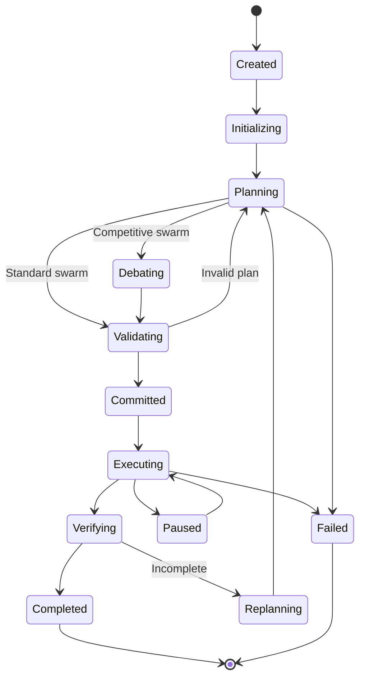
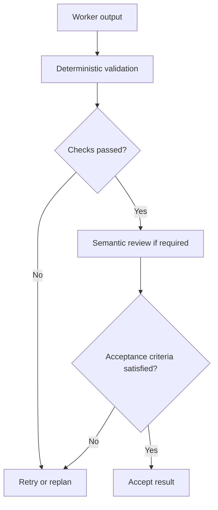

### Naelao — Configurable Planner–Worker Swarm Specification

Scope: Two orchestration architectures only:

* Standard Swarm: One planner coordinating one or multiple workers.

* Competitive Swarm: Multiple independent planners proposing, challenging, debating and refining plans before workers execute the selected plan.

Both architectures support configurable models, mixed-model execution, adaptive agent allocation, template-defined configurations, budget management, verification, and runtime controls.

This specification is intended as an extension of Naelao's existing swarm architecture, not a replacement for the entire agent runtime. Exact integration points will need to be mapped against the existing codebase.

### 1\. Core objectives

The swarm engine must allow Naelao to:

* Execute complex objectives using inexpensive models.

* Improve planning quality through competitive reasoning.

* Combine models from different providers in the same swarm.

* Allow users to control how much intelligence and compute a task receives.

* Support one planner and one worker as the simplest configuration.

* Scale to multiple planners and multiple workers for complex objectives.

* Prevent unnecessary agent spawning, uncontrolled recursion and excessive spending.

* Package orchestration configurations inside space and project templates.

* Operate with both Naelao Managed and BYOK model providers.

* Measure whether additional planners actually improve task completion.

The architecture must remain model-agnostic. GLM Flash, GPT Luna, Claude Opus, Muse Spark and other models are interchangeable resources rather than hardcoded architectural dependencies.

### 2\. Supported swarm architectures

### 2.1 Standard Swarm

### Responsibilities

The single planner is responsible for understanding the objective, decomposing it into tasks, determining dependencies, allocating workers, monitoring progress, reviewing outputs, handling failures and assembling the final result.

Workers are responsible for executing assigned tasks within their authorized capabilities.

### Minimum configuration

```yaml
architecture: standard

planners:
  max_active: 1
  model: glm-flash

workers:
  max_active: 1
  default_model: glm-flash
```

### Expanded configuration

```yaml
architecture: standard

planners:
  max_active: 1
  model: gpt-luna

workers:
  max_active: 10
  default_model: glm-flash

execution:
  adaptive_sizing: true
  parallel_execution: true
```

The standard architecture should be the default because it has lower coordination overhead and is sufficient for most routine tasks.

### 2.2 Competitive Swarm

The competitive swarm introduces multiple planners that independently generate plans, examine competing proposals, challenge assumptions and produce a stronger execution plan.

Importantly, competing planners do not independently launch their own execution swarms by default.

They compete over what should be executed, and workers execute the committed plan.

This prevents duplicated work, conflicting actions and unnecessary spending.

### 3\. Core terminology

| Entity         | Definition                                               |
| -------------- | -------------------------------------------------------- |
| Swarm          | A logical group of planners and workers                  |
| Swarm run      | One execution of an objective                            |
| Objective      | The desired outcome and its constraints                  |
| Planner        | Agent responsible for planning and coordination          |
| Lead planner   | Planner authorized to coordinate execution               |
| Candidate plan | A proposed execution strategy                            |
| Critique       | Structured evaluation of a candidate plan                |
| Debate round   | One cycle of critique and revision                       |
| Committed plan | Validated plan selected for execution                    |
| Worker         | Agent assigned an executable task                        |
| Task           | Bounded unit of work                                     |
| Artifact       | Output produced by a worker                              |
| Evaluator      | Logical role responsible for evaluating plans or results |
| Orchestrator   | Deterministic system managing the swarm lifecycle        |

Evaluator, critic and synthesizer are logical roles that existing planners can perform. They do not require permanently separate agent types.

### 4\. Architectural components

| Component              | Responsibility                            |
| ---------------------- | ----------------------------------------- |
| Swarm orchestrator     | Controls the complete lifecycle           |
| Configuration resolver | Resolves inherited swarm settings         |
| Planner manager        | Creates and manages planners              |
| Debate engine          | Coordinates competitive planning          |
| Plan validator         | Validates proposed plans                  |
| Plan selector          | Selects or synthesizes a committed plan   |
| Task scheduler         | Schedules tasks according to dependencies |
| Worker manager         | Allocates worker execution capacity       |
| Model router           | Resolves models and providers             |
| Budget controller      | Enforces financial and token limits       |
| Context manager        | Provides scoped context to agents         |
| Artifact manager       | Stores worker outputs                     |
| Verification engine    | Checks task and objective completion      |
| Event bus              | Distributes lifecycle events              |
| Observability layer    | Records usage, latency and outcomes       |

The orchestrator must be deterministic application logic, not another unrestricted LLM agent.

LLMs propose decisions. The orchestrator validates and applies them.

### 5\. Configuration hierarchy

Swarm configurations must support inheritance.

Platform defaults

Available architectures and platform limits

Organization settings

Approved models, security and financial limits

Space template

Default orchestration for the space

Space instance

User-customized space configuration

Project template

Project-specific orchestration defaults

Project instance

Project-specific overrides

Workflow or agent

Specialized execution preferences

Individual run

Temporary authorized overrides

### 5.1 Resolution rules

The most specific configuration wins for ordinary preferences.

Restrictive policies accumulate across all levels.

For example:

| Setting                | Organization | Space | Project request | Effective |
| ---------------------- | ------------ | ----- | --------------- | --------- |
| Maximum planners       | 5            | 3     | 8               | 3         |
| Maximum workers        | 50           | 20    | 10              | 10        |
| Monthly budget         | $100         | $30   | $10             | $10       |
| Premium models allowed | No           | Yes   | Yes             | No        |

An organization-level prohibition cannot be overridden by a template, project or individual task.

### 5.2 Configuration snapshots

Every swarm run must store an immutable snapshot of its effective configuration.

Changing project settings during an active run must not silently change its architecture or model assignments.

Emergency restrictions, revoked permissions and exhausted budgets must still apply immediately.

### 5.3 Template portability

Templates must contain model requirements and preferences, not provider secrets.

A template can declare:

```yaml
model_preferences:
  primary: gpt-luna
  alternatives:
    - glm-flash
    - claude-haiku

requirements:
  tool_calling: true
  structured_output: true
  minimum_context_window: 32000
```

When installed, Naelao resolves the logical model identifiers against available provider accounts and user permissions.

### 6\. Complete swarm configuration schema

The following is a proposed canonical configuration contract.

Model identifiers are illustrative logical aliases, not guaranteed provider API identifiers.

```yaml
schema_version: "1.0"

swarm:
  enabled: true

  # standard | competitive
  architecture: competitive

  adaptive_sizing: true

  planners:
    min_active: 2
    max_active: 3

    default_model:
      model: glm-flash
      provider: auto
      credential_source: naelao_managed

    assignments:
      - id: planner-primary
        perspective: balanced
        model: glm-flash

      - id: planner-alternative
        perspective: alternative
        model: gpt-luna

      - id: planner-critical
        perspective: critical
        model: glm-flash

    execution:
      parallel_initial_planning: true
      max_plan_revisions: 2
      timeout_seconds: 120

  debate:
    enabled: true

    # competitive | collaborative
    style: competitive

    independent_initial_plans: true
    anonymous_candidates: true

    min_rounds: 1
    max_rounds: 2

    critique:
      enabled: true
      strategy: assigned_peers
      require_evidence: true
      max_critiques_per_planner: 2

    selection:
      strategy: weighted_evaluation
      synthesizer_model: gpt-luna
      allow_plan_synthesis: true
      validate_before_commit: true

    early_stop:
      enabled: true
      stop_on_validated_consensus: true
      stop_on_budget_pressure: true
      stop_on_no_material_improvement: true

  workers:
    min_active: 1
    max_active: 10

    max_total_instances: 30
    max_tasks_per_worker: 10

    default_model:
      model: glm-flash
      provider: auto
      credential_source: naelao_managed

    model_pool:
      - model: glm-flash
        roles:
          - research
          - execution
          - coding
          - analysis

      - model: gpt-luna
        roles:
          - complex_execution
          - verification

    allow_model_routing: true
    allow_worker_reuse: true
    allow_worker_reassignment: true
    allow_worker_subdelegation: false

  execution:
    max_total_tasks: 100
    max_total_model_calls: 300

    max_parallel_tasks: 10
    max_parallel_model_calls: 15

    max_run_duration_seconds: 3600
    max_task_duration_seconds: 300

    max_task_retries: 2
    max_replans: 2

    max_delegation_depth: 1

    failure_policy: replan
    checkpointing: true

  verification:
    enabled: true
    deterministic_checks_first: true

    planner_review: true
    independent_review: false

    reviewer_model: gpt-luna

    require_artifact_validation: true
    require_objective_validation: true

  escalation:
    enabled: true

    allowed_models:
      - gpt-luna
      - gpt-sol
      - claude-opus

    triggers:
      - repeated_task_failure
      - unresolved_planner_disagreement
      - failed_verification
      - insufficient_model_capability

    max_escalations_per_run: 2
    require_budget_check: true

  budget:
    currency: USD

    max_cost_per_run: 0.50
    max_cost_per_day: 2.00
    max_cost_per_month: 20.00

    max_total_tokens_per_run: 2000000

    planning_budget_fraction: 0.25
    execution_budget_fraction: 0.60
    verification_budget_fraction: 0.15

    reserve_before_execution: true
    hard_limit: true

    on_exhaustion: pause

  context:
    shared_objective: true
    shared_artifacts: true

    isolate_initial_planner_context: true
    isolate_worker_task_context: true

    allow_cross_planner_messages: true
    allow_worker_peer_messages: false

  observability:
    record_model_usage: true
    record_plan_versions: true
    record_critiques: true
    record_task_events: true
    record_cost_breakdown: true

    expose_debate_summary_to_user: true
```

The numerical limits above are proposed defaults for development and testing. They are not measured optimal settings.

### 7\. Model allocation system

### 7.1 Independent model selection

Every planner and worker can have its own model configuration.

Naelao must support all of the following configurations without architectural changes.

| Configuration       | Planners                | Workers               |
| ------------------- | ----------------------- | --------------------- |
| Economy standard    | 1 GLM                   | GLM                   |
| Economy competitive | 3 GLM                   | GLM                   |
| Mixed competitive   | 2 GLM + 1 Luna          | GLM                   |
| Premium planning    | 1 Opus + 1 Sol + 1 Luna | GLM                   |
| Premium execution   | 3 premium planners      | Mixed premium workers |
| Fully customized    | User-selected models    | User-selected models  |

### 7.2 Model reference

```typescript
interface ModelReference {
  modelId: string;

  providerId?: string;

  credentialSource:
    | "naelao_managed"
    | "byok";

  credentialReference?: string;

  reasoningEffort?:
    | "low"
    | "medium"
    | "high";

  temperature?: number;

  maxOutputTokens?: number;

  fallbackModels?: string[];
}
```

Provider-specific unsupported parameters must be omitted or rejected during validation.

### 7.3 Model capabilities

The model registry should track:

```typescript
interface ModelCapabilities {
  toolCalling: boolean;
  structuredOutput: boolean;
  streaming: boolean;

  vision: boolean;
  audio: boolean;
  video: boolean;

  reasoningControls: boolean;
  promptCaching: boolean;

  contextWindow: number;
  maxOutputTokens: number;

  supportsParallelToolCalls: boolean;
}
```

A worker requiring image analysis must not be assigned a text-only model.

A planner requiring structured task graphs must use a model and adapter capable of producing validated structured outputs.

### 7.4 Provider selection

Provider routing must consider model availability, pricing, latency, rate limits, privacy policies, caching support, reliability and user preferences.

The cheapest provider should not automatically win if its tool-calling reliability is inadequate.

### 7.5 Mixed-model debate

Mixed-model debate should be a first-class capability.

For example:

Planner A

GLM Flash

Cost-efficient solution

Planner B

GPT Luna

Alternative solution

Planner C

Claude Opus

Deep critical analysis

Different model families may reduce correlated reasoning failures, although that benefit must be benchmarked rather than assumed.

### 8\. Swarm run lifecycle

* Initialize run

    Resolve objective, configuration, permissions and budget.

* Allocate planners

    Determine the required number of planners and assign models.

* Generate plans

    Produce one plan or multiple independent candidate plans.

* Debate

    Competitive architecture only. Critique and revise proposals.

* Commit execution plan

    Validate the selected plan and assign a lead planner.

* Allocate workers

    Create or reuse workers according to task requirements.

* Execute tasks

    Schedule independent tasks in parallel and dependent tasks in order.

* Verify results

    Validate artifacts, task outputs and objective completion.

* Replan if necessary

    Resolve failures or missing requirements within configured limits.

* Finalize

    Deliver results, persist artifacts and reconcile usage.

### 8.1 Run state machine



Cancellation must be supported from every nonterminal state. Budget exhaustion can pause a run at any stage.

### 9\. Objective contract

Every run starts with a structured objective.

```typescript
interface SwarmObjective {
  id: string;

  organizationId: string;
  spaceId: string;
  projectId?: string;

  requestedBy: string;

  description: string;

  expectedDeliverables: Deliverable[];

  constraints: Constraint[];

  acceptanceCriteria: AcceptanceCriterion[];

  contextReferences: string[];

  allowedCapabilities: string[];

  deadline?: string;

  budgetOverride?: number;
}
```

The objective must distinguish between what the user wants, what the swarm is permitted to do and how successful completion will be evaluated.

For example, researching suppliers is not equivalent to being authorized to purchase from suppliers.

### 10\. Planner allocation

### 10.1 Fixed allocation

When adaptive sizing is disabled, the orchestrator uses the configured planner count.

For a standard swarm, that count is always one.

For a competitive swarm, the configured count must be at least two.

### 10.2 Adaptive allocation

When adaptive sizing is enabled, the orchestrator determines the appropriate number of planners.

| Complexity     | Suggested planners |
| -------------- | ------------------ |
| Routine        | 1                  |
| Simple         | 1                  |
| Moderate       | 2                  |
| Complex        | 3                  |
| Highly complex | 4–5                |
| Exceptional    | Configured maximum |

A competitive-enabled project may use a standard execution path for routine tasks if adaptive fallback is explicitly allowed.

Complexity estimation should consider the number of deliverables, dependencies, ambiguity, risk, required tools, historical failure rates and estimated execution cost.

The maximum planner setting is a ceiling, not a requirement to consume that capacity.

### 10.3 Planner perspectives

The system should provide configurable perspectives.

| Perspective     | Planning objective                           |
| --------------- | -------------------------------------------- |
| Balanced        | Produce a practical overall solution         |
| Efficiency      | Minimize resources and latency               |
| Quality         | Maximize completeness and accuracy           |
| Critical        | Identify hidden risks and failure conditions |
| Alternative     | Explore substantially different approaches   |
| Creative        | Explore unconventional solutions             |
| Domain-specific | Apply specialized domain knowledge           |

Users and template builders can define custom perspectives.

Perspectives must not override the objective, security rules or acceptance criteria.

### 11\. Standard planner execution protocol

The standard planner receives the objective, available capabilities, project context, model pool, budget, execution constraints and acceptance criteria.

It returns a structured candidate plan.

The orchestrator validates the plan before scheduling workers.

During execution, the planner receives structured progress updates rather than being continuously invoked for every minor event.

The planner is invoked when:

* A meaningful group of tasks completes.

* A task fails after permitted retries.

* New information invalidates a dependency.

* A worker requests clarification.

* A required decision cannot be resolved deterministically.

* Final verification is required.

This avoids wasting tokens on unnecessary planner calls.

### 12\. Competitive planning protocol

This is the central extension to the standard swarm.

### 12.1 Phase A — Independent planning

All allocated planners receive the same canonical objective and constraints.

Each planner receives its own perspective and model configuration.

During initial planning:

* Planners cannot see competing plans.

* Planners cannot see other planners' critiques.

* Planners cannot modify shared project state.

* Planners cannot launch execution workers.

* Planners may use explicitly authorized read-only discovery tools.

This reduces anchoring and encourages independent exploration.

### 12.2 Phase B — Candidate submission

Each planner submits a structured candidate plan.

```typescript
interface CandidatePlan {
  id: string;
  runId: string;
  plannerId: string;

  version: number;

  summary: string;

  assumptions: Assumption[];

  tasks: PlannedTask[];

  dependencies: TaskDependency[];

  risks: IdentifiedRisk[];

  estimatedCostUsd: number;
  estimatedDurationSeconds: number;

  acceptanceCoverage: string[];

  requiredCapabilities: string[];

  verificationStrategy: VerificationStep[];

  status:
    | "proposed"
    | "under_review"
    | "revised"
    | "rejected"
    | "selected";
}
```

Candidate plans must use the same output contract so they can be compared consistently.

### 12.3 Phase C — Initial validation

Before debate begins, the deterministic validator checks every candidate.

| Validation   | Requirement                                  |
| ------------ | -------------------------------------------- |
| Schema       | Valid structured output                      |
| Dependencies | No circular task dependencies                |
| Capabilities | All required tools are available             |
| Permissions  | No unauthorized actions                      |
| Budget       | Estimated cost fits the available allocation |
| Scope        | Plan addresses the requested objective       |
| Limits       | Task and agent counts remain within policy   |
| Deliverables | Required outputs are represented             |

Invalid plans may receive a bounded repair attempt.

A plan with unauthorized actions must not become executable simply because other planners approve it.

### 12.4 Phase D — Cross-critique

Planners receive competing candidate plans and evaluate them.

Candidate identities should be anonymized where practical to reduce model prestige bias.

Each planner evaluates:

* Missing requirements.

* Incorrect assumptions.

* Invalid dependencies.

* Unnecessary tasks.

* Cost inefficiencies.

* Security and operational risks.

* Verification weaknesses.

* Alternative execution strategies.

Critiques must reference specific tasks, assumptions or acceptance criteria.

Generic statements such as "Plan B is worse" are insufficient.

### 12.5 Critique contract

```typescript
interface PlanCritique {
  id: string;

  runId: string;
  round: number;

  reviewerPlannerId: string;
  targetPlanId: string;

  findings: CritiqueFinding[];

  suggestedChanges: SuggestedChange[];

  strengths: string[];

  blockingIssues: string[];

  overallRecommendation:
    | "accept"
    | "revise"
    | "reject";
}

interface CritiqueFinding {
  id: string;

  severity:
    | "info"
    | "minor"
    | "major"
    | "blocking";

  category:
    | "correctness"
    | "completeness"
    | "efficiency"
    | "security"
    | "dependency"
    | "verification"
    | "budget";

  targetReference: string;

  explanation: string;

  evidenceReferences: string[];

  proposedResolution?: string;
}
```

### 12.6 Phase E — Defense and revision

Each planner receives critiques targeting its plan.

It can accept a critique, reject it with supporting evidence, partially accept it or revise the relevant section.

A planner must not be required to defend its original proposal if another proposal is demonstrably better.

The goal is improved execution quality, not winning an argument.

```typescript
interface CritiqueResponse {
  critiqueFindingId: string;

  decision:
    | "accepted"
    | "rejected"
    | "partially_accepted";

  justification: string;

  evidenceReferences: string[];

  resultingPlanVersion?: number;
}
```

All revised plans are stored as new immutable versions.

### 12.7 Phase F — Additional debate rounds

If configured, another critique and revision cycle occurs.

The debate engine must enforce:

* Maximum rounds.

* Maximum total model calls.

* Maximum critique size.

* Maximum debate duration.

* Maximum planning cost.

* Early termination when additional rounds offer no material improvement.

### 12.8 Debate topology

The competitive architecture supports two critique strategies.

All-to-all

Every planner critiques every other plan.

Assigned peers

Each planner reviews a bounded subset of plans.

All-to-all debate scales quadratically with planner count.

For three planners, it produces six directed peer reviews per round. For ten planners, it produces ninety.

Assigned-peer review should be the default for larger planning councils.

### 12.9 Early termination

Debate can stop when:

* A valid plan satisfies all acceptance criteria and no unresolved blocking critique remains.

* The maximum number of rounds is reached.

* The planning budget is exhausted.

* Additional rounds produce no measurable improvement.

* The remaining planners cannot resolve disagreement within available resources.

Consensus alone is not proof of correctness.

### 13\. Plan selection and synthesis

After debate, Naelao must select one committed execution plan.

### 13.1 Selection strategies

| Strategy              | Behaviour                                        |
| --------------------- | ------------------------------------------------ |
| Best candidate        | Select the strongest valid existing plan         |
| Weighted evaluation   | Score valid plans against configured criteria    |
| Synthesis             | Combine compatible strengths from multiple plans |
| Independent evaluator | Use a designated model to assess the plans       |

These are selection strategies within the competitive swarm, not additional swarm architectures.

### 13.2 Default evaluation criteria

Correctness and feasibility

30%

Objective coverage

25%

Reliability and risk management

20%

Resource efficiency

15%

Verification quality

10%

Weights should be configurable by templates.

Hard constraints such as authorization and budget compliance are pass/fail gates, not weighted criteria.

A high-quality but unauthorized plan must always be rejected.

### 13.3 Synthesis requirements

The synthesizer must not simply concatenate competing plans.

It must remove duplicated tasks, resolve contradictory assumptions, normalize dependencies, preserve acceptance criteria and produce one coherent task graph.

The synthesized plan must pass the same validation process as an original candidate.

### 13.4 Lead planner assignment

After a plan is selected, one planner becomes the lead planner.

Selection options include the primary planner, the winning planner, a user-selected planner or a planner selected according to capability and cost.

Only the lead planner can propose execution graph modifications during ordinary execution.

The remaining planners become dormant unless requested for another planning or verification round.

This avoids paying for all planners throughout the entire execution lifecycle.

### 14\. Execution plan and task graph

The committed plan is represented as a directed acyclic graph.

Independent tasks execute concurrently. Dependent tasks wait for validated prerequisites.

### 14.1 Task contract

```typescript
interface PlannedTask {
  id: string;

  title: string;
  description: string;

  expectedOutput: OutputSpecification;

  acceptanceCriteria: AcceptanceCriterion[];

  dependencies: string[];

  requiredCapabilities: string[];

  preferredWorkerRole?: string;

  preferredModel?: ModelReference;

  inputArtifactReferences: string[];

  allowedToolIds: string[];

  estimatedTokens?: number;
  estimatedCostUsd?: number;

  priority: number;

  timeoutSeconds: number;
  maxRetries: number;

  sideEffectClass:
    | "read_only"
    | "internal_write"
    | "external_action"
    | "financial_action";

  requiresApproval: boolean;
}
```

### 14.2 Task states

```typescript
type TaskState =
  | "pending"
  | "blocked"
  | "ready"
  | "assigned"
  | "running"
  | "awaiting_approval"
  | "verifying"
  | "succeeded"
  | "retrying"
  | "failed"
  | "cancelled"
  | "skipped";
```

Tasks become ready only when all required dependencies have succeeded.

A skipped dependency is acceptable only when the plan explicitly defines it as optional.

### 15\. Worker architecture

### 15.1 Worker responsibilities

Workers receive bounded tasks and execute them using authorized tools and context.

A worker must not redefine the overall objective, change the committed plan, increase its own budget, modify its permissions or spawn additional agents without explicit authorization.

Workers can report discoveries, propose new tasks and request replanning.

The lead planner and orchestrator determine whether those requests are accepted.

### 15.2 Worker allocation

Workers can be:

* Homogeneous: all workers use the same model.

* Heterogeneous: workers use different models.

* Role-based: models are assigned according to task specialization.

* Dynamically routed: models are selected based on task requirements and available budget.

### 15.3 Worker roles

| Role                | Example responsibility              |
| ------------------- | ----------------------------------- |
| General worker      | Routine task execution              |
| Research worker     | Information discovery               |
| Coding worker       | Code implementation                 |
| Analysis worker     | Data processing                     |
| Document worker     | Document generation                 |
| Verification worker | Output validation                   |
| Integration worker  | Authorized external tool operations |

Worker roles are capability profiles, not necessarily permanent agent instances.

### 15.4 Worker reuse

The worker manager should support reusing compatible worker instances across tasks within a run.

Reuse is permitted when the worker has the correct capabilities, sufficient context capacity, compatible permissions and no conflicting task state.

Task-specific context must be cleared or appropriately isolated between unrelated assignments.

Cross-tenant worker context reuse is prohibited.

### 15.5 Worker result contract

```typescript
interface WorkerResult {
  runId: string;
  taskId: string;
  workerId: string;

  attempt: number;

  status:
    | "completed"
    | "partial"
    | "failed"
    | "blocked";

  summary: string;

  artifacts: ArtifactReference[];

  evidenceReferences: string[];

  acceptanceResults: AcceptanceResult[];

  discoveredIssues: string[];

  proposedFollowupTasks?: PlannedTask[];

  usage: ModelUsage[];

  error?: ExecutionError;
}
```

A worker's claim that a task succeeded does not automatically mark the task as successful.

The result must pass the configured verification requirements.

### 16\. Worker concurrency and scheduling

### 16.1 Distinguish concurrency from total execution

The following settings are separate:

| Setting                    | Meaning                            |
| -------------------------- | ---------------------------------- |
| Max active workers         | Workers simultaneously active      |
| Max total worker instances | Total workers created during a run |
| Max total tasks            | Total tasks allowed in a run       |
| Max parallel tasks         | Tasks executing simultaneously     |
| Max model calls            | Total LLM requests permitted       |
| Max parallel model calls   | Concurrent provider requests       |

A swarm with ten concurrent workers can execute one hundred tasks sequentially in batches without creating one hundred simultaneous workers.

### 16.2 Scheduling algorithm

```typescript
async function scheduleReadyTasks(runId: string) {
  const run = await loadRun(runId);

  if (!canContinue(run)) return;

  const readyTasks = await getReadyTasks(runId);

  const availableSlots =
    run.limits.maxConcurrentWorkers -
    await countActiveWorkers(runId);

  const selectedTasks = prioritize(readyTasks)
    .slice(0, Math.max(0, availableSlots));

  for (const task of selectedTasks) {
    const reservation =
      await reserveTaskBudget(run, task);

    if (!reservation.approved) {
      await pauseForBudget(runId);
      break;
    }

    await enqueueTaskAtomically(
      task,
      reservation
    );
  }
}
```

The production implementation must use atomic reservations and task claims to prevent concurrent schedulers from exceeding limits or assigning the same task twice.

### 16.3 Priority

Tasks should be prioritized by critical-path importance, user priority, deadline, dependency availability, cost and resource requirements.

A blocked task must not occupy an active worker slot indefinitely.

### 17\. Communication protocol

All agent communication must pass through the orchestrator or an authorized message bus.

### 17.1 Supported messages

```typescript
type SwarmMessageType =
  | "objective_assigned"
  | "plan_proposed"
  | "critique_submitted"
  | "critique_response"
  | "plan_revised"
  | "plan_committed"
  | "task_assigned"
  | "task_progress"
  | "task_completed"
  | "task_failed"
  | "clarification_requested"
  | "replan_requested"
  | "verification_requested"
  | "verification_completed"
  | "budget_warning"
  | "cancellation_requested";
```

### 17.2 Message envelope

```typescript
interface SwarmMessage {
  id: string;

  organizationId: string;
  runId: string;

  senderId: string;
  recipientId: string;

  type: SwarmMessageType;

  correlationId: string;
  causationId?: string;

  payload: unknown;

  createdAt: string;

  idempotencyKey: string;
}
```

### 17.3 Communication restrictions

Planners can communicate during authorized debate phases.

Workers communicate with the lead planner through structured progress and result messages.

Direct worker-to-worker communication is disabled by default. Workers exchange necessary information through shared artifacts and task dependencies.

This reduces unbounded conversations and makes execution easier to audit.

### 18\. Context management

Naelao must not send the entire space or project context to every planner and worker.

### 18.1 Context layers

Platform instructions

Security, policies and execution rules

Space context

Relevant shared knowledge and capabilities

Project context

Objectives, memory and existing artifacts

Swarm context

Current objective and committed plan

Agent context

Planner perspective or worker task

Execution context

Relevant tool results and recent events

### 18.2 Planner context

Planners receive the canonical objective, constraints, available tools, relevant project knowledge, budget and expected deliverables.

During debate, they additionally receive relevant candidate plans and critiques.

### 18.3 Worker context

Workers receive only their task, required dependency artifacts, applicable project knowledge, tool permissions and acceptance criteria.

Workers do not need the complete debate transcript.

### 18.4 Artifact references

Large outputs should be stored as artifacts and referenced by identifier.

```typescript
interface ArtifactReference {
  artifactId: string;

  type: string;
  mimeType: string;

  sizeBytes: number;

  checksum: string;

  summary?: string;

  createdByTaskId: string;
}
```

The context manager retrieves only relevant artifact sections.

### 18.5 Prompt caching

Stable instructions, tool definitions and reusable project context should be organized into cache-friendly prefixes where supported.

Cache behavior must be measured per provider. Naelao must not assume that repeated context will always receive discounted cached-token pricing.

### 19\. Replanning and error recovery

### 19.1 Local retry

A worker task can be retried when a failure is transient or recoverable.

Examples include provider timeouts, temporary tool errors, malformed structured outputs and recoverable execution failures.

### 19.2 Worker reassignment

If a worker repeatedly fails, the orchestrator may assign the task to another compatible worker or model.

### 19.3 Standard replanning

The lead planner receives the failure report and proposes a bounded modification to the remaining execution graph.

Completed valid tasks should not be rerun unnecessarily.

### 19.4 Competitive replanning

The planning council may be reactivated when the failure invalidates the original strategy, exposes a major unresolved assumption or requires a substantially different approach.

The council receives:

* The original objective.

* The committed plan.

* Completed artifacts.

* Failure evidence.

* Remaining budget.

* Remaining execution constraints.

It competes over how to complete the remaining work, rather than restarting the entire objective.

### 19.5 Replanning limits

Every replan consumes the configured replan allowance.

When the allowance is exhausted, the swarm must pause, return a partial result or fail according to policy.

It must never enter an unlimited planner-worker failure loop.

### 20\. Verification architecture

Verification should occur at three levels.

### 20.1 Task-level verification

Determine whether the worker produced the required output.

Examples include schema validation, file existence checks, automated tests, arithmetic verification and tool response validation.

### 20.2 Plan-level verification

Determine whether the committed task graph has completed successfully and whether required dependencies and deliverables are present.

### 20.3 Objective-level verification

Determine whether the final result satisfies the user's original objective.

Completing every planned task does not necessarily mean the objective was achieved.

### 20.4 Verification priority



Deterministic validation should take priority whenever an objective check is available.

An LLM reviewer is useful for semantic assessment but must not replace security enforcement, permission checks or executable tests.

### 21\. Budget management

### 21.1 Supported limits

Naelao must support financial limits at organization, space, project and run levels.

Token limits, model call limits and execution time limits must also be supported independently.

### 21.2 Cost reservation

Before making a provider request, the budget controller estimates the maximum possible cost using input tokens, maximum output tokens, reasoning-token billing where applicable and provider pricing.

It atomically reserves the estimated cost.

After completion, actual provider usage is reconciled and unused reservations are released.

### 21.3 Budget exhaustion behavior

Supported policies:

| Policy         | Behaviour                               |
| -------------- | --------------------------------------- |
| Pause          | Wait for additional authorized budget   |
| Return partial | Finalize available verified results     |
| Downgrade      | Use cheaper approved models if suitable |
| Reduce swarm   | Allocate fewer planners or workers      |
| Fail           | Terminate with a budget error           |

Downgrading must be explicitly permitted and must not compromise mandatory quality or security requirements.

### 21.4 Interactive cost estimator

The following calculator illustrates how planner count, debate rounds and model selection affect costs.

Rates use our earlier GLM Pareto and Luna estimates, assuming 70% cached input, 20% uncached input and 10% output. These are illustrative rates, not live pricing.

### Swarm cost simulator

StandardCompetitive

Planners

3

Debate rounds

1

Planner modelGLM Flash

Tokens per planner per round2M

Workers used per run

10

Worker modelGLM Flash

Tokens per worker5M

Synthesizer modelGPT Luna

Runs per month

10

Estimated inference cost per run

### $1.720

Planning

$

0.303

Workers

$

1.263

Synthesis

$

0.154

Total tokens per run

### 64.0M

Monthly inference cost

### $17.20

Excludes retries, separate verification calls, tool costs, infrastructure and provider fees. Debate token usage is simplified.

### 22\. Persistence and database schema

The swarm engine requires durable persistence.

The following tables are proposed logical entities. They should be mapped onto Naelao's existing database conventions rather than creating duplicate infrastructure.

| Table                     | Purpose                                     |
| ------------------------- | ------------------------------------------- |
| swarm_configs             | Versioned orchestration configurations      |
| swarm_runs                | Objective execution instances               |
| swarm_run_configs         | Immutable effective configuration snapshots |
| swarm_planners            | Planner instances and model assignments     |
| swarm_workers             | Worker instances and capabilities           |
| swarm_plans               | Candidate and committed plan versions       |
| swarm_critiques           | Structured planner critiques                |
| swarm_debate_rounds       | Debate lifecycle records                    |
| swarm_tasks               | Task graph nodes                            |
| swarm_task_dependencies   | Task graph edges                            |
| swarm_task_attempts       | Worker execution attempts                   |
| swarm_artifacts           | Produced outputs                            |
| swarm_messages            | Structured communication                    |
| swarm_events              | Append-only lifecycle events                |
| swarm_usage               | Model and tool usage                        |
| swarm_budget_reservations | Reserved and reconciled costs               |
| swarm_checkpoints         | Recoverable execution state                 |

### 22.1 Swarm run record

```typescript
interface SwarmRunRecord {
  id: string;

  organizationId: string;
  spaceId: string;
  projectId?: string;

  objectiveId: string;

  architecture:
    | "standard"
    | "competitive";

  configSnapshotId: string;

  state: string;

  committedPlanId?: string;
  leadPlannerId?: string;

  reservedCostUsd: number;
  actualCostUsd: number;

  totalModelCalls: number;
  totalTokens: number;

  replanCount: number;

  createdAt: string;
  startedAt?: string;
  completedAt?: string;

  version: number;
}
```

### 22.2 Persistence requirements

Every record must be tenant-scoped.

Plan versions and audit events must be immutable.

State transitions must use transactional updates or optimistic concurrency control.

Large artifacts should be stored outside the primary relational database, with metadata and references persisted in the database.

### 23\. Cloudflare implementation mapping

Given Naelao's Cloudflare-oriented architecture, the swarm engine could use the following infrastructure.

| Cloudflare component        | Proposed responsibility                      |
| --------------------------- | -------------------------------------------- |
| Workers                     | API endpoints and orchestration services     |
| Durable Objects             | Per-run coordination and concurrency control |
| Workflows                   | Durable multistep execution and waiting      |
| Queues                      | Asynchronous planner and worker jobs         |
| D1                          | Persistent relational records                |
| R2                          | Artifacts, large outputs and checkpoints     |
| AI Gateway or model gateway | Provider routing and inference observability |

A possible implementation is one logical coordinator per swarm run, responsible for task claims, state transitions, budget coordination and scheduling.

Long-running model and tool calls should execute outside the coordinator's serialized state-management path.

Organization-level budget reservations require coordination across runs, not merely independent per-run counters.

This is a proposed infrastructure mapping; existing Naelao services and current Cloudflare limits must be reviewed before implementation.

### 24\. API specification

### 24.1 Configuration endpoints

| Method | Endpoint                      |
| ------ | ----------------------------- |
| GET    | /v1/swarm/configs/:id         |
| POST   | /v1/swarm/configs             |
| PATCH  | /v1/swarm/configs/:id         |
| POST   | /v1/swarm/configs/validate    |
| GET    | /v1/projects/:id/swarm-config |
| PUT    | /v1/projects/:id/swarm-config |
| GET    | /v1/spaces/:id/swarm-config   |
| PUT    | /v1/spaces/:id/swarm-config   |

### 24.2 Execution endpoints

| Method | Endpoint                    |
| ------ | --------------------------- |
| POST   | /v1/swarm/runs              |
| GET    | /v1/swarm/runs/:id          |
| GET    | /v1/swarm/runs/:id/plans    |
| GET    | /v1/swarm/runs/:id/tasks    |
| GET    | /v1/swarm/runs/:id/planners |
| GET    | /v1/swarm/runs/:id/workers  |
| GET    | /v1/swarm/runs/:id/usage    |
| GET    | /v1/swarm/runs/:id/events   |
| POST   | /v1/swarm/runs/:id/pause    |
| POST   | /v1/swarm/runs/:id/resume   |
| POST   | /v1/swarm/runs/:id/cancel   |
| POST   | /v1/swarm/runs/:id/replan   |

### 24.3 Create run request

```json
{
  "spaceId": "space_123",
  "projectId": "project_456",
  "objective": {
    "description": "Research competitors and produce a report",
    "expectedDeliverables": [
      {
        "type": "document",
        "format": "markdown"
      }
    ]
  },
  "overrides": {
    "architecture": "competitive",
    "maxPlanners": 3,
    "maxWorkers": 5,
    "maxCostUsd": 0.25
  }
}
```

### 24.4 Create run response

```json
{
  "runId": "swarm_run_123",
  "state": "created",
  "architecture": "competitive",
  "effectiveLimits": {
    "maxPlanners": 3,
    "maxWorkers": 5,
    "maxCostUsd": 0.25
  }
}
```

Every mutation endpoint requires authorization and idempotency support where repeated requests could create duplicate execution.

### 25\. Event system

The swarm engine must publish structured lifecycle events.

```text
swarm.run.created
swarm.run.initialized

swarm.planner.allocated
swarm.planner.started
swarm.planner.completed
swarm.planner.failed

swarm.plan.proposed
swarm.plan.validated
swarm.plan.rejected
swarm.plan.revised
swarm.plan.committed

swarm.debate.started
swarm.debate.round.started
swarm.debate.critique.submitted
swarm.debate.round.completed
swarm.debate.completed

swarm.worker.allocated
swarm.worker.released

swarm.task.ready
swarm.task.assigned
swarm.task.started
swarm.task.progress
swarm.task.completed
swarm.task.failed
swarm.task.retrying

swarm.verification.started
swarm.verification.completed

swarm.budget.reserved
swarm.budget.reconciled
swarm.budget.warning
swarm.budget.exhausted

swarm.run.replanning
swarm.run.paused
swarm.run.resumed
swarm.run.completed
swarm.run.failed
swarm.run.cancelled
```

These events allow Naelao's interface to display live swarm execution, support debugging and maintain recoverable execution history.

Event consumers must tolerate duplicate delivery and use event identifiers for deduplication.

### 26\. User interface specification

### 26.1 Space and project settings

Users should be able to configure both swarm architectures through a simple settings panel, with advanced options expandable when required.

### Swarm configuration

Project settings

Swarm architecture

Standard swarm

One planner coordinates one or more workers.

Competitive swarm

Multiple planners debate before workers execute the selected plan.

Adaptive swarm sizing

Allocate only the planners and workers required for each task.Planner modelGLM Flash

Maximum concurrent workers5

Default worker modelGLM FlashMaximum cost per run ($)

Advanced settings

Copy configuration JSONFunctional settings prototype. Configuration can be copied but is not saved to a live Naelao project.

### 26.2 Template builder interface

Space and project template builders must be able to define:

* Default swarm architecture.

* Default and maximum planner counts.

* Default and maximum worker counts.

* Planner perspectives.

* Recommended models.

* Debate settings.

* Verification requirements.

* Budget recommendations.

* Allowed user overrides.

Template recommendations must remain subordinate to organization policies.

### 26.3 Per-run override

When starting a task, the user may temporarily select standard or competitive execution, choose permitted models, adjust maximum planners and workers, and specify a run budget.

Temporary overrides must not permanently modify the project configuration.

### 27\. Live swarm visualization

Naelao should expose swarm activity through its existing workspace and project interface.

### Competitive swarm

Example run · Research and strategy

Executing

Objective progress

65%

Planning council

Planner AGLM Flash

Plan selected

Planner BGPT Luna

Critique completed

Planner CGLM Flash

Dormant

Workers

Worker 1

Complete

Competitor research

Worker 2

Complete

Pricing analysis

Worker 3

Running

Market segmentation

Worker 4

Running

Report generation

Worker 5

Queued

Waiting for dependencies

Planners

### 3

Workers

### 5

Cost

### $0.084

Illustrative execution state.

### 27.1 Debate visibility

Users should be able to inspect candidate plan summaries, major disagreements, identified risks, accepted critiques, rejected alternatives and the reason a plan was selected.

The interface should display structured planning artifacts and concise decision summaries, rather than depending on access to private model reasoning traces.

### 27.2 Runtime controls

Authorized users must be able to pause, resume, cancel, approve sensitive actions, increase the budget, inspect artifacts and request replanning.

Cancellation must prevent new tasks from being scheduled and propagate cancellation signals to active workers.

Already completed external actions cannot necessarily be reversed.

### 28\. Security and permissions

### 28.1 Planner authority

Planners propose actions but cannot grant permissions.

A planner must not authorize its own proposed external action or override a human approval requirement.

### 28.2 Worker authority

Workers receive task-scoped capabilities.

For example:

```yaml
worker_permissions:
  tools:
    - documents.read
    - web.search
    - artifacts.write

  denied:
    - email.send
    - payments.execute
    - credentials.export
```

### 28.3 Debate restrictions

Competing planners must not execute irreversible actions while arguing about the plan.

Read-only discovery may be allowed. External side effects require a committed task, permission checks and applicable approval.

### 28.4 AgentPort integration

When swarm tasks access organization-owned external accounts through AgentPort, they must use scoped access grants.

Sensitive actions should follow the existing proposed AgentPort pattern:

Propose → Evaluate → Approve → Execute.

Approval must bind to the exact immutable action payload and authenticated approving identity.

A worker must not be able to alter an approved payload after approval.

### 28.5 Prompt injection

External documents, websites, tool outputs and worker-generated content must be treated as untrusted data.

Instructions discovered in these sources must not override the swarm's objective, authorization or security policies.

### 28.6 Multi-tenancy

Every model request, artifact lookup, tool invocation and state mutation must be associated with the correct tenant and execution identity.

Provider credentials must never be exposed directly to planners or workers.

### 29\. Reliability and durable execution

The swarm engine must assume that model providers, network calls, queues and execution environments can fail.

### 29.1 Idempotency

Every task attempt must have a unique execution identifier.

External actions must use provider-supported idempotency keys where available.

If a request times out after an external action may have succeeded, the system must reconcile the external state before retrying.

### 29.2 Checkpointing

Checkpoints should be created after initial planning, each debate round, plan commitment, successful task completion, replanning and verification.

A resumed run should reconstruct its state from persisted records rather than restarting all planners and workers.

### 29.3 Worker leases

Workers should claim tasks through time-limited leases.

Expired leases can be recovered after checking whether the original worker is still active and whether external actions have already occurred.

### 29.4 Provider failure

If a model provider becomes unavailable, Naelao may retry, switch to an approved fallback provider, switch to an approved fallback model or pause.

Provider failover must respect data residency, privacy and model capability requirements.

### 30\. Observability and cost accounting

Every swarm run must record:

| Metric              | Purpose                        |
| ------------------- | ------------------------------ |
| Total cost          | Financial accounting           |
| Planner cost        | Planning efficiency            |
| Debate cost         | Competitive reasoning overhead |
| Worker cost         | Execution efficiency           |
| Verification cost   | Quality-control overhead       |
| Input tokens        | Context consumption            |
| Cached tokens       | Cache effectiveness            |
| Output tokens       | Generation consumption         |
| Model calls         | Execution overhead             |
| Task success rate   | Reliability                    |
| Retry count         | Failure detection              |
| Replan count        | Planning quality               |
| Debate rounds       | Reasoning overhead             |
| Execution latency   | User experience                |
| Human interventions | Autonomy measurement           |

Provider usage records must distinguish cached and uncached tokens where reported.

Reasoning tokens should not be counted twice if they are already included in billed output tokens.

### 30.1 Cost per successful objective

The most important economic metric is:

\\text{Cost per successful objective}
=
\\frac{\\text{Total inference and execution cost}}
{\\text{Number of successful objectives}}

A competitive swarm that consumes more tokens may still be more economical if it significantly reduces execution failures and retries.

### 31\. Benchmarking the two architectures

Naelao should include a dedicated swarm benchmark suite.

The benchmark should isolate the effect of architecture from the effect of model quality.

### 31.1 Required configurations

| ID  | Architecture | Planners        | Workers |
| --- | ------------ | --------------- | ------- |
| A   | Standard     | 1 GLM           | GLM     |
| B   | Competitive  | 2 GLM           | GLM     |
| C   | Competitive  | 3 GLM           | GLM     |
| D   | Competitive  | 3 GLM + debate  | GLM     |
| E   | Standard     | 1 Luna          | GLM     |
| F   | Competitive  | GLM + Luna      | GLM     |
| G   | Standard     | 1 premium model | GLM     |

Configurations B and C can use independent proposal selection with zero debate rounds, allowing you to isolate the benefit of debate itself.

### 31.2 Benchmark task categories

| Category             | Example                                    |
| -------------------- | ------------------------------------------ |
| Task decomposition   | Convert an objective into executable tasks |
| Dependency reasoning | Identify correct execution order           |
| Research planning    | Produce a complete research strategy       |
| Coding               | Implement and test a bounded feature       |
| Business operations  | Complete a simulated operational workflow  |
| Error recovery       | Recover from injected tool failures        |
| Budget management    | Complete tasks within a spending limit     |
| Security             | Reject unauthorized instructions           |
| Ambiguous objectives | Identify missing requirements              |
| Verification         | Detect incomplete or incorrect outputs     |

### 31.3 Fair evaluation

All configurations must receive identical objectives, available tools, acceptance criteria and execution environments.

Run both:

Equal-budget evaluation: Give every architecture the same financial budget.

Equal-workload evaluation: Give every architecture the same objective and measure actual cost.

Repeat tasks across multiple seeds or runs where affordable.

Report sample sizes and uncertainty rather than presenting small pilot results as definitive evidence.

### 31.4 Proposed $3 pilot

| Configuration                  | Budget |
| ------------------------------ | ------ |
| Standard GLM                   | $0.30  |
| Two competing GLM planners     | $0.35  |
| Three competing GLM planners   | $0.40  |
| Three GLM planners with debate | $0.55  |
| Standard Luna planner          | $0.45  |
| Mixed GLM and Luna planners    | $0.50  |
| Premium planner baseline       | $0.25  |
| Reserve                        | $0.20  |
| Total                          | $3.00  |

This should be treated as a preliminary experiment. The budget may support only a small number of complex tasks, especially for the premium baseline.

### 32\. Recommended default configurations

### 32.1 Economy standard

```yaml
architecture: standard

planners:
  max_active: 1
  model: glm-flash

workers:
  max_active: 3
  default_model: glm-flash

adaptive_sizing: true

verification:
  deterministic_checks_first: true
```

Suitable for routine personal assistant and business operations.

### 32.2 Economy competitive

```yaml
architecture: competitive

planners:
  max_active: 3
  default_model: glm-flash

debate:
  max_rounds: 1
  critique_strategy: assigned_peers
  synthesizer_model: glm-flash

workers:
  max_active: 5
  default_model: glm-flash

adaptive_sizing: true
```

Suitable for testing whether multiple inexpensive planners can replace one stronger planner.

### 32.3 Balanced competitive

```yaml
architecture: competitive

planners:
  max_active: 3

  assignments:
    - model: glm-flash
      perspective: efficiency

    - model: gpt-luna
      perspective: balanced

    - model: glm-flash
      perspective: critical

debate:
  max_rounds: 2
  synthesizer_model: gpt-luna

workers:
  max_active: 10
  default_model: glm-flash

adaptive_sizing: true
```

Suitable for more complex research, coding and business workflows.

### 32.4 Premium competitive

```yaml
architecture: competitive

planners:
  max_active: 3

  assignments:
    - model: claude-opus
      perspective: balanced

    - model: gpt-sol
      perspective: alternative

    - model: gpt-luna
      perspective: critical

debate:
  max_rounds: 2
  synthesizer_model: gpt-sol

workers:
  max_active: 20
  default_model: glm-flash

  allow_model_routing: true

adaptive_sizing: true

escalation:
  enabled: true
```

Suitable for high-value objectives where the user explicitly authorizes a larger inference budget.

These presets are starting hypotheses. Benchmark results should determine the actual defaults.

### 33\. Implementation roadmap

### Phase 1 — Configurable standard swarm

Extend the existing planner-worker architecture with configuration inheritance, independent planner and worker model selection, concurrency limits, budget enforcement, structured task contracts and durable execution.

Completion criteria: Users can configure one planner and one or multiple workers at space and project levels.

### Phase 2 — Independent competitive planners

Implement parallel initial planning, planner perspectives, candidate plan persistence, plan validation and candidate selection.

Completion criteria: Multiple planners can independently propose plans, and workers execute only the selected committed plan.

### Phase 3 — Debate and synthesis

Implement cross-critique, critique responses, immutable plan revisions, debate rounds, early stopping and synthesis.

Completion criteria: Planners can challenge and revise competing plans within bounded cost and execution limits.

### Phase 4 — Mixed-model allocation

Implement per-planner model assignments, heterogeneous worker pools, provider fallback, capability-based routing and optional premium escalation.

Completion criteria: A single swarm can use models from multiple authorized providers.

### Phase 5 — Adaptive execution

Implement complexity estimation, adaptive planner counts, adaptive worker counts, bounded competitive replanning and budget-aware allocation.

Completion criteria: Routine tasks use minimal resources while complex tasks can activate larger swarms.

### Phase 6 — Template integration and benchmarking

Integrate both architectures into space and project templates, implement the benchmark suite, expose execution metrics and provide live swarm visualization.

Completion criteria: Template builders can package reproducible orchestration configurations and evaluate their cost and effectiveness.

### 34\. Required acceptance tests

The implementation is not complete until the following scenarios pass.

| Test                                  | Expected result                                     |
| ------------------------------------- | --------------------------------------------------- |
| Standard swarm with one worker        | Exactly one planner coordinates execution           |
| Standard swarm with ten workers       | Independent tasks execute within concurrency limits |
| Competitive swarm with three planners | Three independent initial plans are generated       |
| Initial planning isolation            | Planners cannot see competing plans prematurely     |
| Zero debate rounds                    | Valid candidates are selected without debate        |
| One debate round                      | Critiques and revisions are recorded                |
| Mixed-model planners                  | Each planner uses its assigned model                |
| Invalid candidate plan                | Candidate is rejected or repaired                   |
| Circular dependencies                 | Plan validation fails                               |
| Unauthorized action                   | Execution is blocked                                |
| Budget exhaustion during debate       | Debate stops or pauses safely                       |
| Budget exhaustion during execution    | No new unauthorized spending occurs                 |
| Concurrent budget reservations        | Shared budget cannot be double-spent                |
| Worker timeout                        | Retry or recovery follows policy                    |
| Duplicate queue message               | Task is not executed twice                          |
| Provider outage                       | Approved fallback or pause occurs                   |
| Failed task verification              | Task is not marked successful                       |
| Replanning                            | Completed valid artifacts are preserved             |
| User cancellation                     | New tasks stop being scheduled                      |
| Configuration inheritance             | Restrictive parent policies remain enforced         |
| Template installation                 | Configuration resolves without embedded secrets     |
| Cross-tenant access                   | Access is denied                                    |
| Maximum debate rounds                 | No additional debate calls occur                    |
| Maximum model calls                   | Further inference is blocked                        |
| Run recovery                          | Execution resumes from durable state                |
| Final objective verification          | Completion reflects actual acceptance criteria      |

### 35\. Non-goals

This specification deliberately does not introduce additional swarm architectures.

The following are outside its scope:

* Fully decentralized peer-to-peer agent networks.

* Unrestricted recursive agent spawning.

* Independent competing execution swarms.

* Autonomous model training.

* A separate template marketplace implementation.

* Redesigning Naelao's entire agent runtime.

* Replacing AgentPort or the model gateway.

The competitive swarm is an extension of planner-worker orchestration, not a completely separate execution platform.

### 36\. Final architectural decision

Naelao should implement one shared swarm execution engine with two interchangeable planning strategies.

Both architectures share the same worker manager, scheduler, task graph, model gateway, permissions, budget controller, artifact storage, verification system and observability infrastructure.

The only fundamental difference is how the execution plan is produced.

```typescript
interface PlanningStrategy {
  generatePlan(
    context: PlanningContext
  ): Promise<CommittedPlan>;
}

class StandardPlanningStrategy
  implements PlanningStrategy {
  async generatePlan(
    context: PlanningContext
  ): Promise<CommittedPlan> {
    // Allocate one planner.
    // Generate a candidate plan.
    // Validate and commit the plan.
    throw new Error("Implementation required");
  }
}

class CompetitivePlanningStrategy
  implements PlanningStrategy {
  async generatePlan(
    context: PlanningContext
  ): Promise<CommittedPlan> {
    // Allocate multiple planners.
    // Generate independent candidates.
    // Validate candidate plans.
    // Run bounded debate rounds.
    // Select or synthesize a plan.
    // Validate and commit the plan.
    throw new Error("Implementation required");
  }
}
```

These interfaces are illustrative implementation contracts, not completed production code.

The shared engine consumes the committed plan regardless of which strategy produced it.

This is the cleanest way to add competitive planning without duplicating Naelao's existing swarm infrastructure.

It also preserves the larger opportunity: a user running inexpensive GLM Flash models can configure several planners to collectively reason about difficult objectives, while another user with a larger budget can combine frontier models in exactly the same architecture.

Naelao provides the orchestration. The user or template determines the intelligence architecture, models and available compute.
